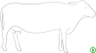
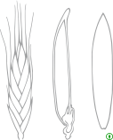

# EMBL-EBI Anatomogram 解剖轮廓：新增31张

[返回本批用途分类](../MORE-OPEN-ART-2026-11-05.md)

本来源新增SVG 31张、原生高清 0张、原生标准 0张。人体、脑、模式动物与植物原始SVG；灰色轮廓及隐藏器官高亮层保持原样。

固定版本：[9fcc37022cce1e2862692a5f5fbfb78572b87e67](https://github.com/ebi-gene-expression-group/anatomogram/tree/9fcc37022cce1e2862692a5f5fbfb78572b87e67)。许可概览：CC-BY-4.0；使用时请保留逐图作者、原作品链接和具体许可。

标准尺寸位图适合PPT中的小幅示意图，放大前请核对实际宽高；SVG可按需要放大。完整署名保存在[全库清单](../../data/manifest.csv)。

原件默认展示灰色轮廓，器官高亮层保留在SVG中，未擅自显色或把隐藏层计作新图片。

## 预览

## 下载分册

| 分册 | 图片数 | 范围 |
| --- | ---: | --- |
| [第1册](ebi-anatomogram-01.md) | 31 | 1–31 |
