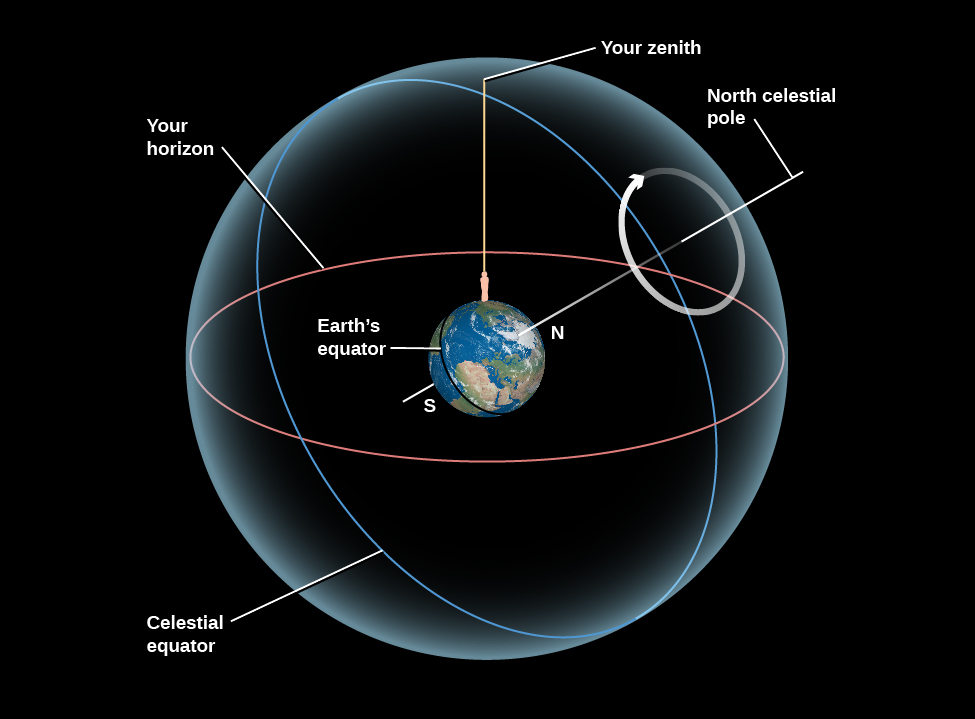
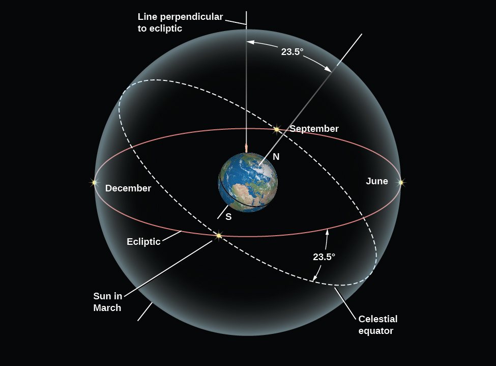
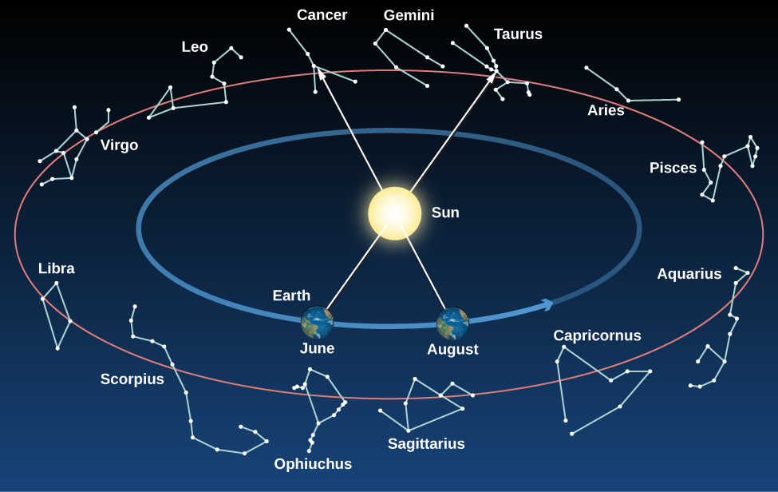
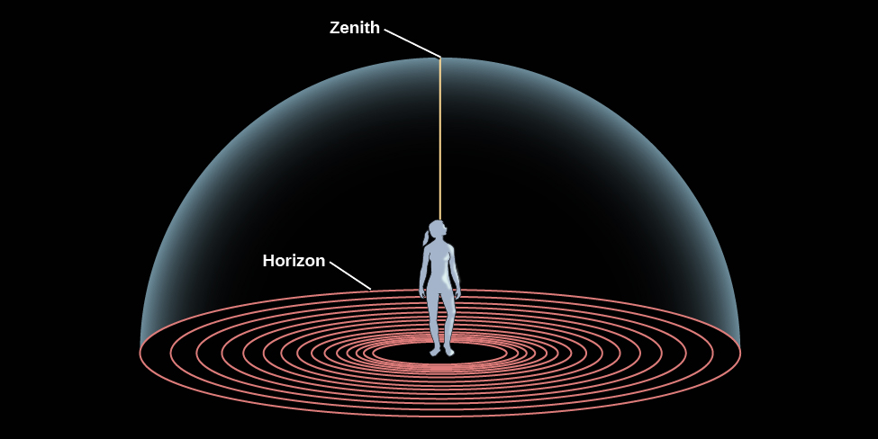
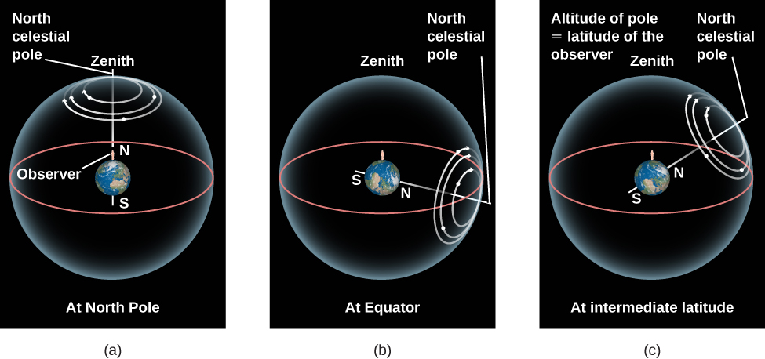
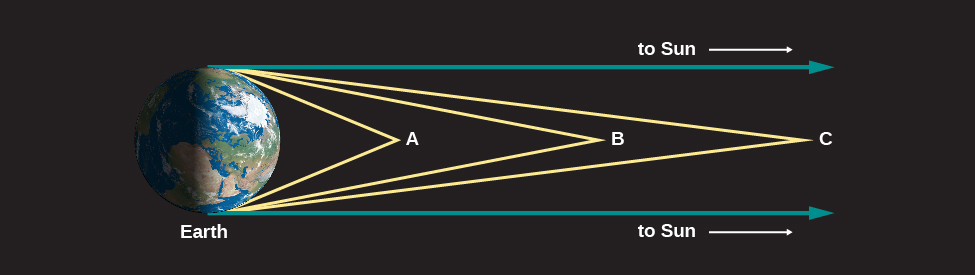

# OpenStax 天文学历史开放插画：新增119张

[返回本批用途分类](../MORE-OPEN-ART-2026-11-05.md)

本来源新增SVG 0张、原生高清 0张、原生标准 119张。历史CC BY4固定版本中的天球、行星、恒星及宇宙学示意图；按真实标准像素尺寸收录。

固定版本：[63157f370b09c06a4cc12832384aaaf4de1ced3b](https://github.com/openstax/osbooks-astronomy/tree/63157f370b09c06a4cc12832384aaaf4de1ced3b)。许可概览：CC-BY-4.0；使用时请保留逐图作者、原作品链接和具体许可。

标准尺寸位图适合PPT中的小幅示意图，放大前请核对实际宽高；SVG可按需要放大。完整署名保存在[全库清单](../../data/manifest.csv)。

## 预览

## 下载分册

| 分册 | 图片数 | 范围 |
| --- | ---: | --- |
| [第1册](openstax-astronomy-01.md) | 100 | 1–100 |
| [第2册](openstax-astronomy-02.md) | 19 | 101–119 |
