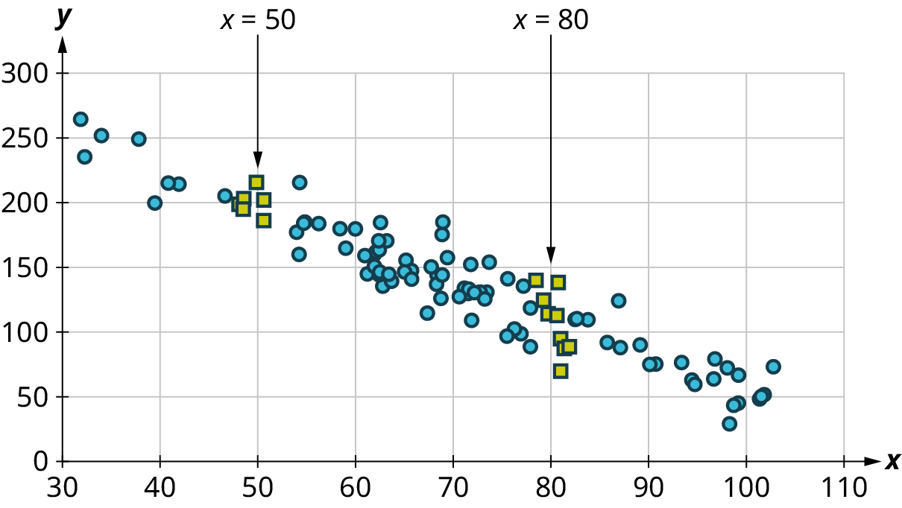
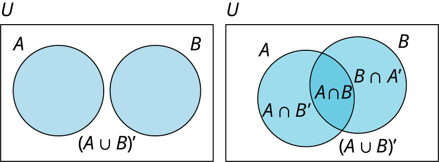
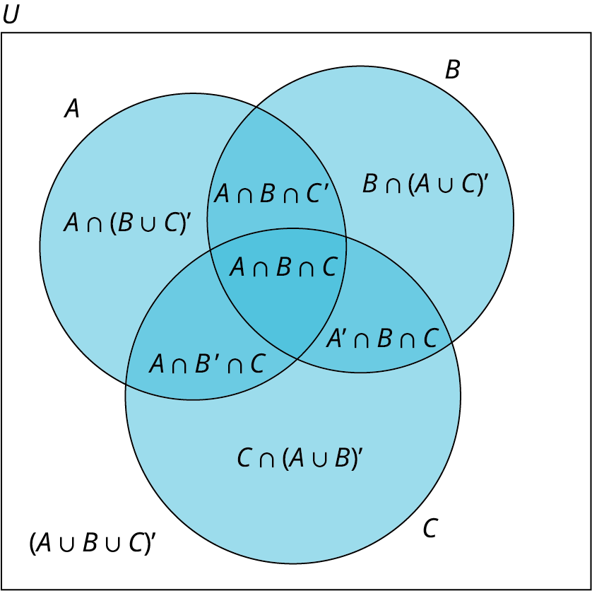
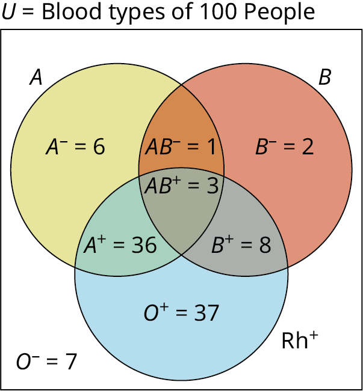
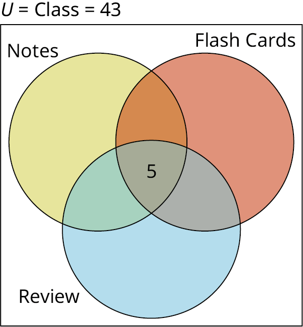

# OpenStax 现代数学历史开放图：新增412张

[返回本批用途分类](../MORE-OPEN-ART-2026-11-05.md)

本来源新增SVG 0张、原生高清 21张、原生标准 391张。网络图、图论、几何、统计与应用数学原图；不收纯文字表或空坐标模板。

固定版本：[fa7c1a151783958fd2c114da66831e3d57ce2321](https://github.com/openstax/osbooks-contemporary-mathematics/tree/fa7c1a151783958fd2c114da66831e3d57ce2321)。许可概览：CC-BY-4.0；使用时请保留逐图作者、原作品链接和具体许可。

标准尺寸位图适合PPT中的小幅示意图，放大前请核对实际宽高；SVG可按需要放大。完整署名保存在[全库清单](../../data/manifest.csv)。

## 预览

## 下载分册

| 分册 | 图片数 | 范围 |
| --- | ---: | --- |
| [第1册](openstax-contemporary-math-01.md) | 100 | 1–100 |
| [第2册](openstax-contemporary-math-02.md) | 100 | 101–200 |
| [第3册](openstax-contemporary-math-03.md) | 100 | 201–300 |
| [第4册](openstax-contemporary-math-04.md) | 100 | 301–400 |
| [第5册](openstax-contemporary-math-05.md) | 12 | 401–412 |
