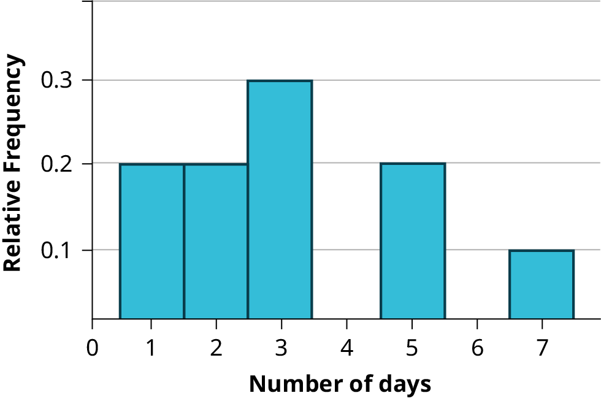
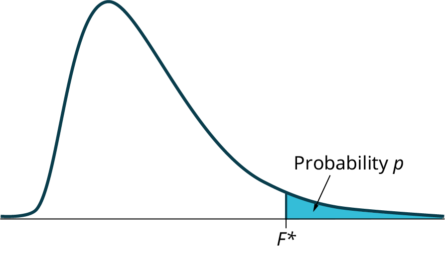
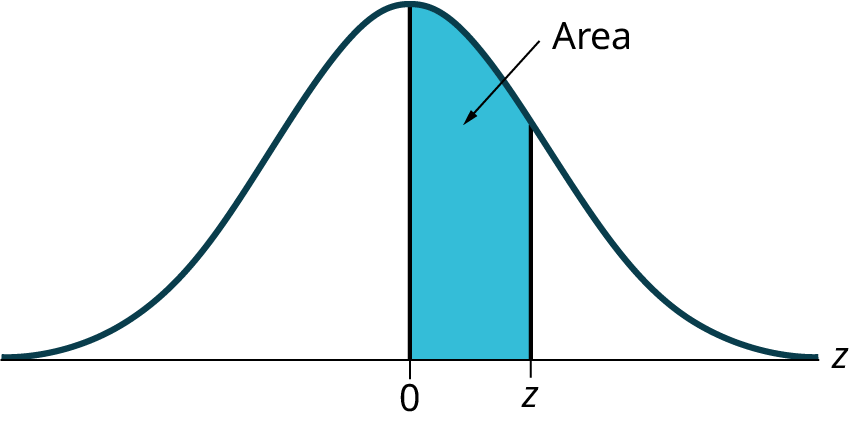
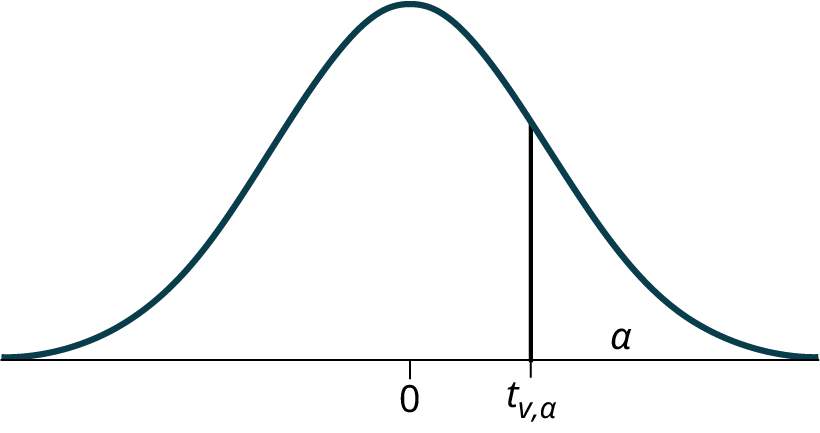
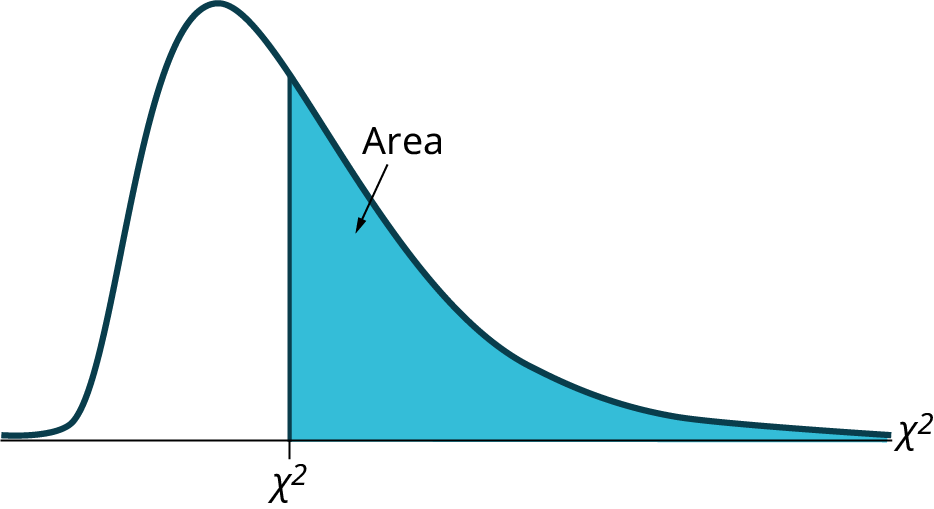
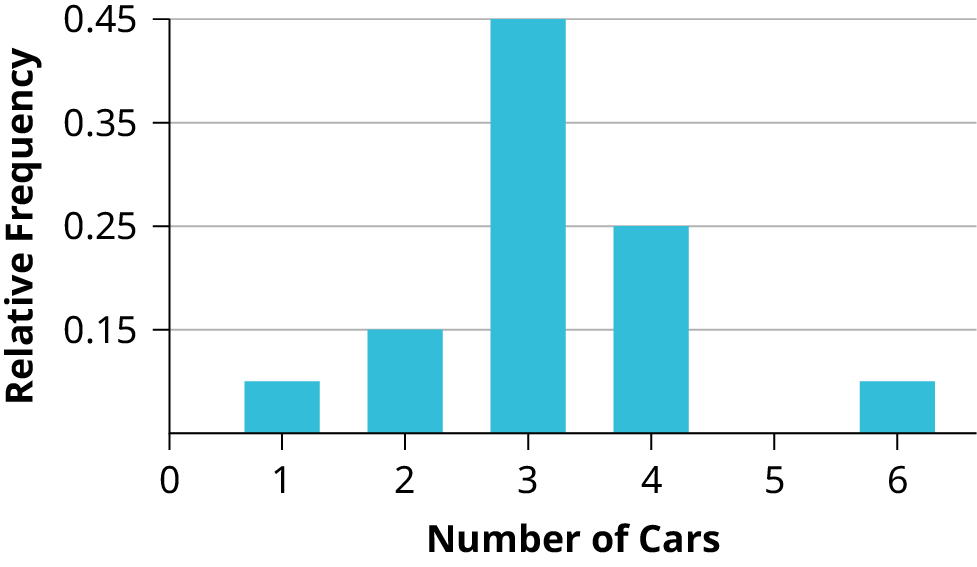

# OpenStax 统计学与商业统计历史开放图：新增339张

[返回本批用途分类](../MORE-OPEN-ART-2026-11-05.md)

本来源新增SVG 0张、原生高清 19张、原生标准 320张。抽样、分布、回归、假设检验与数据可视化原图，保留历史CC BY4章节证据。

固定版本：[50ec91749080bb040b57bb40c34337cacc994cba](https://github.com/openstax/osbooks-introductory-statistics-bundle/tree/50ec91749080bb040b57bb40c34337cacc994cba)。许可概览：CC-BY-4.0；使用时请保留逐图作者、原作品链接和具体许可。

标准尺寸位图适合PPT中的小幅示意图，放大前请核对实际宽高；SVG可按需要放大。完整署名保存在[全库清单](../../data/manifest.csv)。

## 预览

## 下载分册

| 分册 | 图片数 | 范围 |
| --- | ---: | --- |
| [第1册](openstax-intro-statistics-01.md) | 100 | 1–100 |
| [第2册](openstax-intro-statistics-02.md) | 100 | 101–200 |
| [第3册](openstax-intro-statistics-03.md) | 100 | 201–300 |
| [第4册](openstax-intro-statistics-04.md) | 39 | 301–339 |
