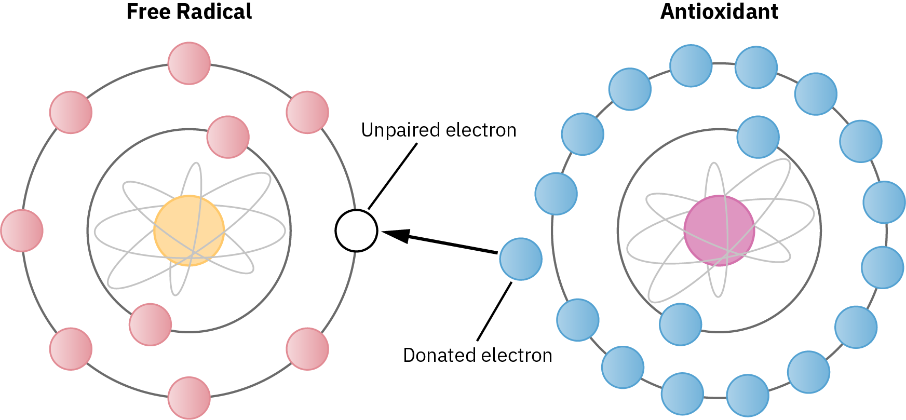
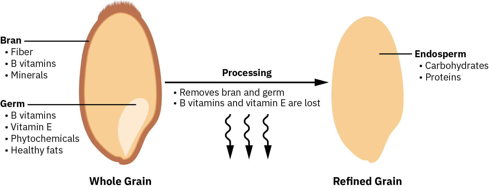
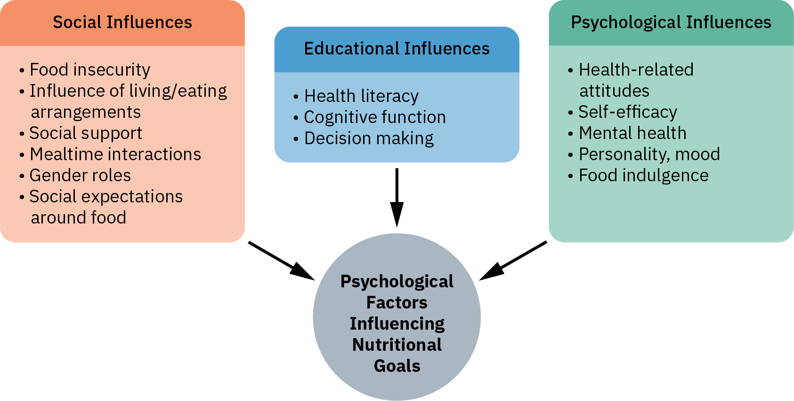
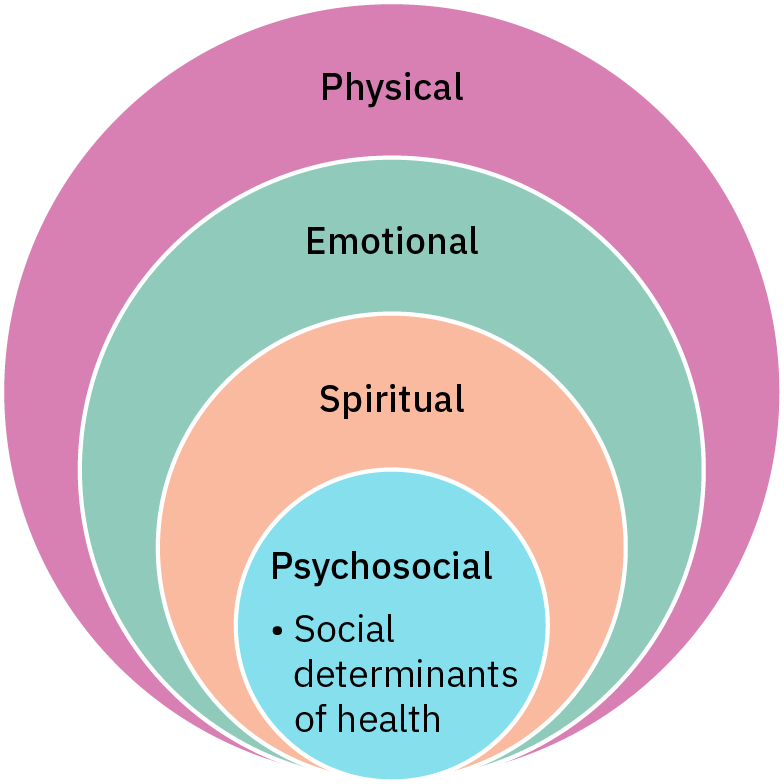
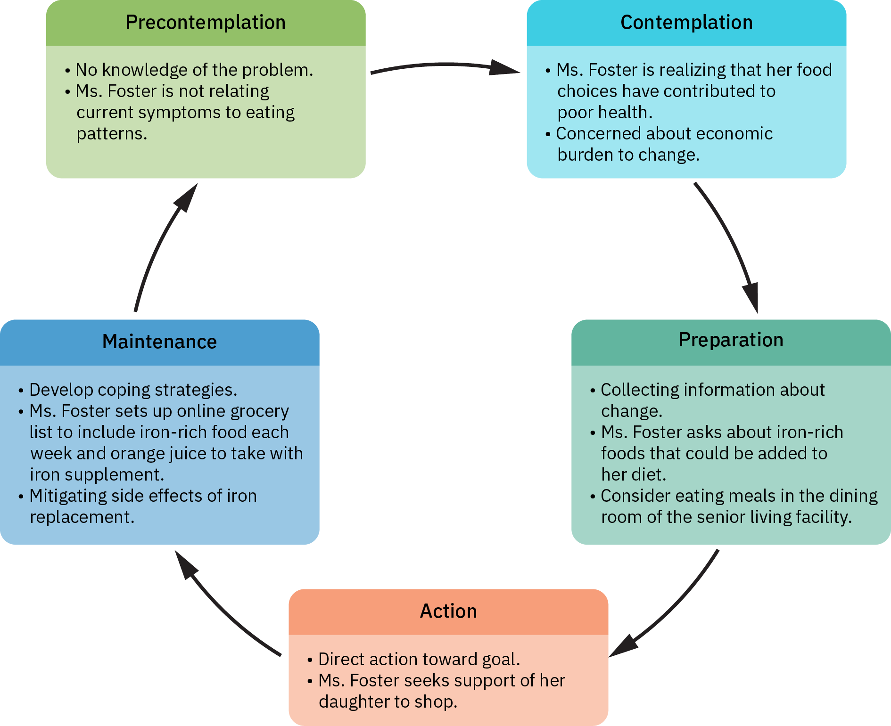
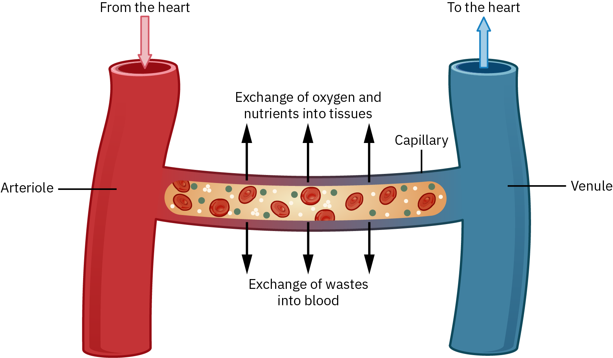

# OpenStax 护理与药理历史开放插画：新增64张

[返回本批用途分类](../MORE-OPEN-ART-2026-11-05.md)

本来源新增SVG 0张、原生高清 28张、原生标准 36张。历史CC BY4固定版本中的药理、营养与公共卫生原图；逐图排查第三方图片及已收教材改编。

固定版本：[f0124920c65609137effe2333dea327d1c77accc](https://github.com/openstax/osbooks-nursing-external-bundle/tree/f0124920c65609137effe2333dea327d1c77accc)。许可概览：CC-BY-4.0；使用时请保留逐图作者、原作品链接和具体许可。

标准尺寸位图适合PPT中的小幅示意图，放大前请核对实际宽高；SVG可按需要放大。完整署名保存在[全库清单](../../data/manifest.csv)。

## 预览

## 下载分册

| 分册 | 图片数 | 范围 |
| --- | ---: | --- |
| [第1册](openstax-nursing-01.md) | 64 | 1–64 |
