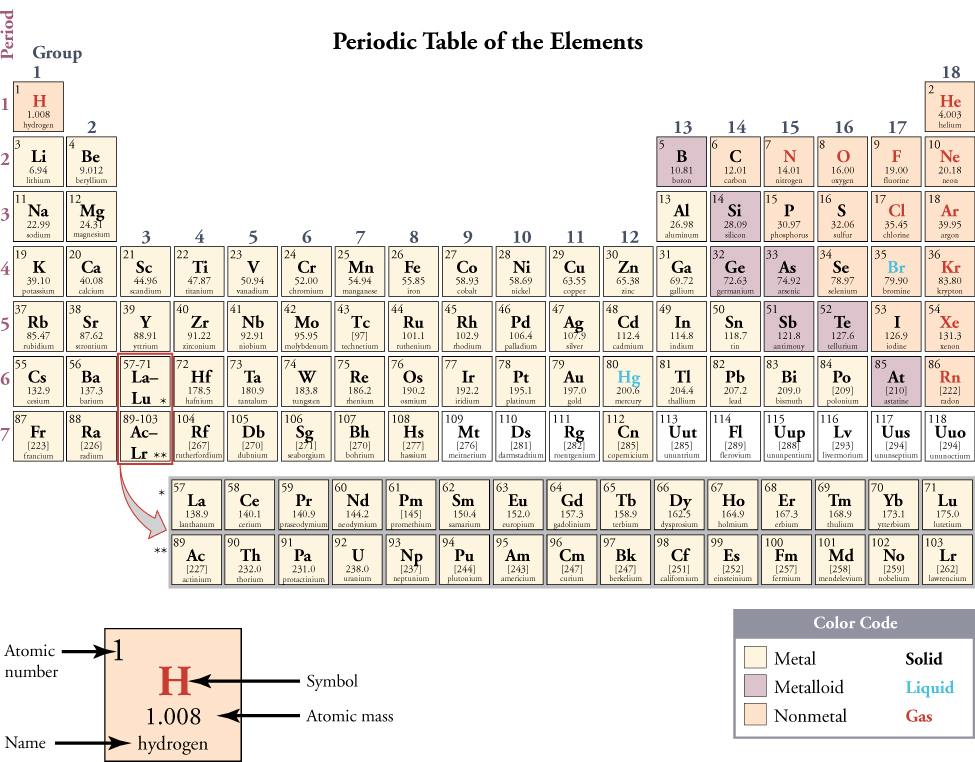
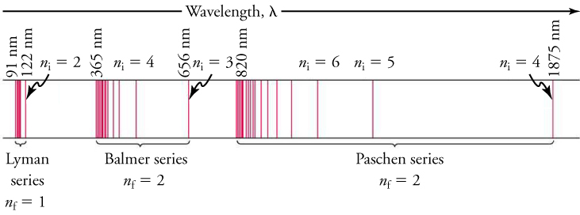
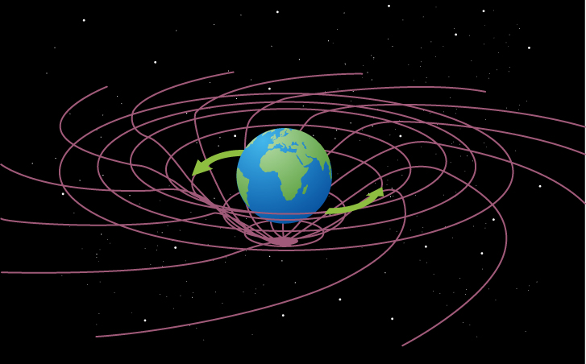
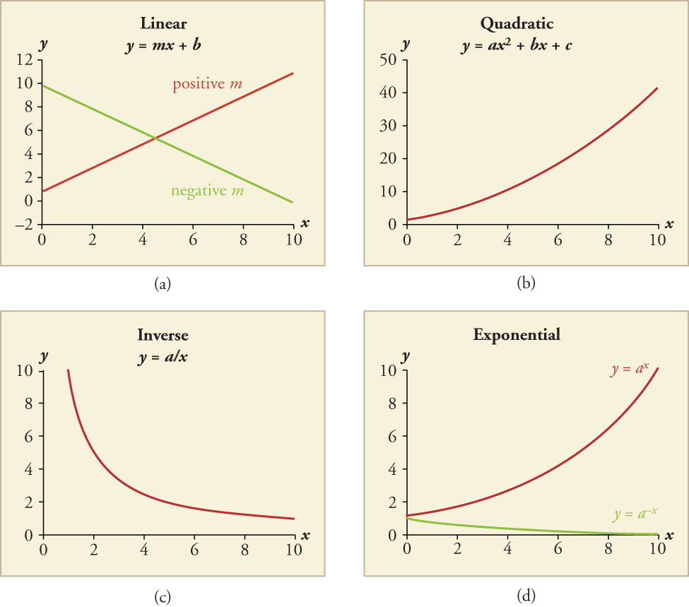
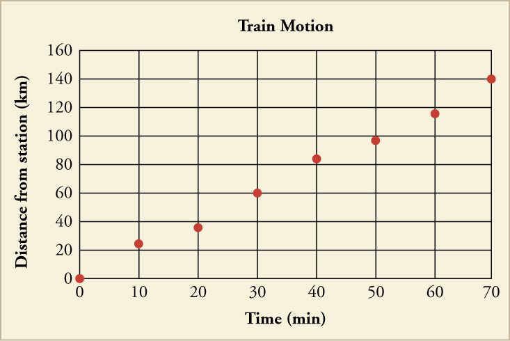
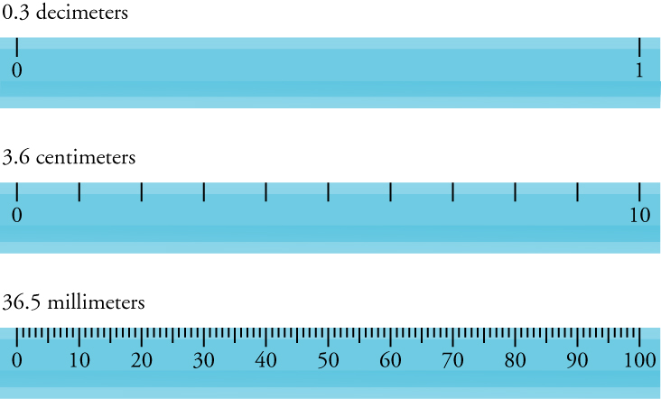

# OpenStax 高中物理开放插画：新增90张

[返回本批用途分类](../MORE-OPEN-ART-2026-11-05.md)

本来源新增SVG 0张、原生高清 0张、原生标准 90张。独立Physics教材中的力学、光学、电磁学和实验装置原图；与既有物理图集分开核验。

固定版本：[1297afa141b898d35c40be2823076f690c238371](https://github.com/openstax/osbooks-physics/tree/1297afa141b898d35c40be2823076f690c238371)。许可概览：CC-BY-4.0；使用时请保留逐图作者、原作品链接和具体许可。

标准尺寸位图适合PPT中的小幅示意图，放大前请核对实际宽高；SVG可按需要放大。完整署名保存在[全库清单](../../data/manifest.csv)。

## 预览

## 下载分册

| 分册 | 图片数 | 范围 |
| --- | ---: | --- |
| [第1册](openstax-physics-01.md) | 90 | 1–90 |
