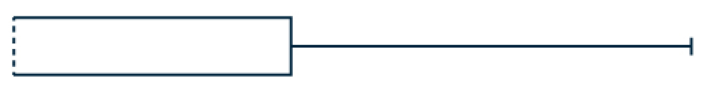
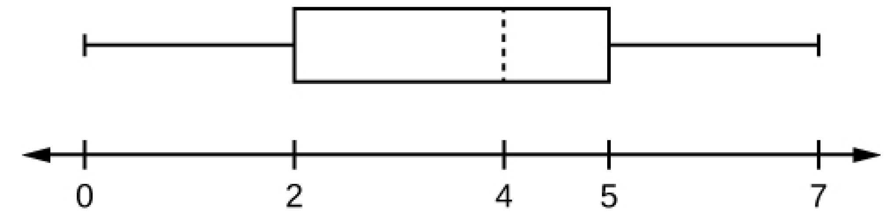
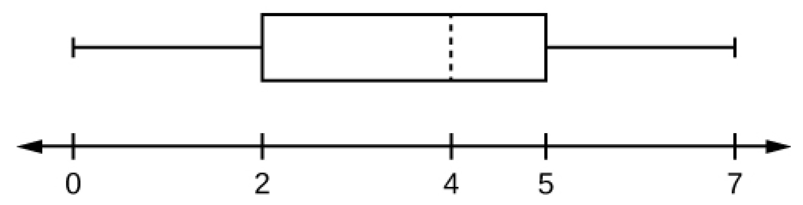
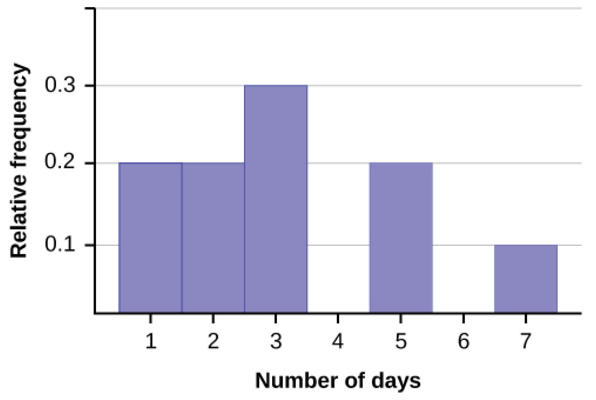
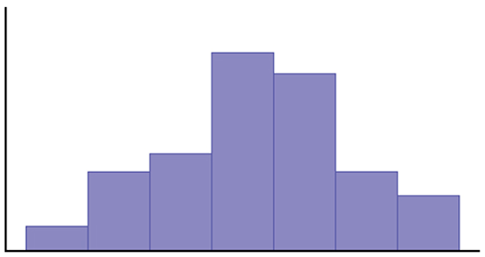
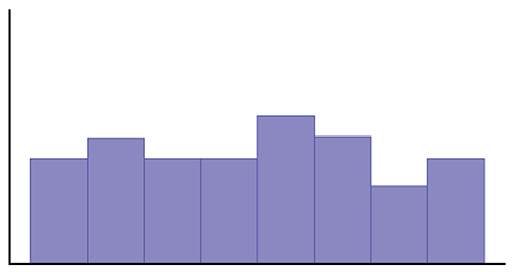

# OpenStax 统计学开放图：新增48张

[返回本批用途分类](../MORE-OPEN-ART-2026-11-05.md)

本来源新增SVG 0张、原生高清 9张、原生标准 39张。概率分布、回归、抽样与推断统计原图；排除截图和空坐标模板。

固定版本：[7dea80ae2800386d470b11f6528962f9c4992d15](https://github.com/openstax/osbooks-statistics/tree/7dea80ae2800386d470b11f6528962f9c4992d15)。许可概览：CC-BY-4.0；使用时请保留逐图作者、原作品链接和具体许可。

标准尺寸位图适合PPT中的小幅示意图，放大前请核对实际宽高；SVG可按需要放大。完整署名保存在[全库清单](../../data/manifest.csv)。

## 预览

## 下载分册

| 分册 | 图片数 | 范围 |
| --- | ---: | --- |
| [第1册](openstax-statistics-01.md) | 48 | 1–48 |
