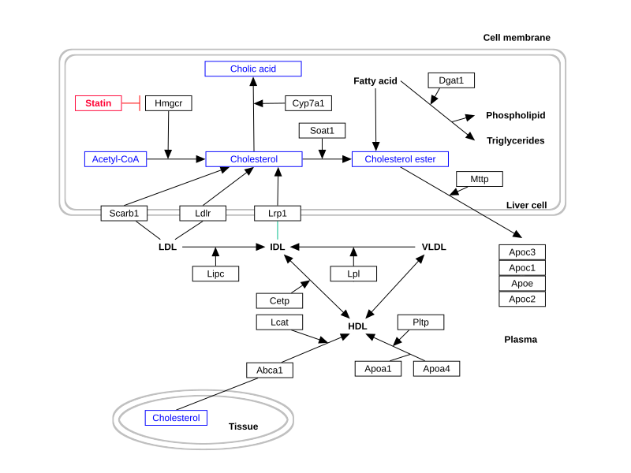
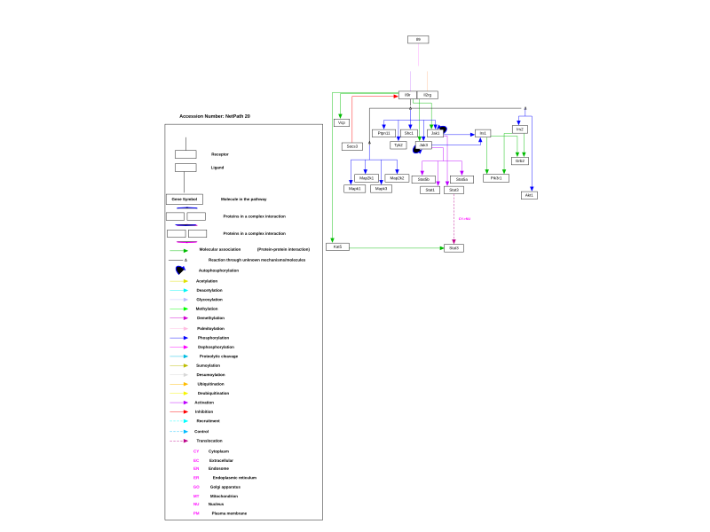
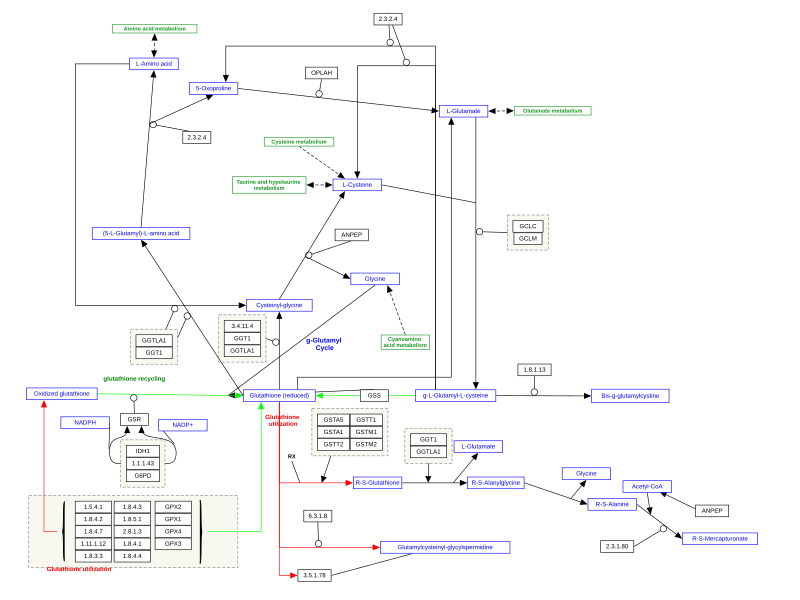
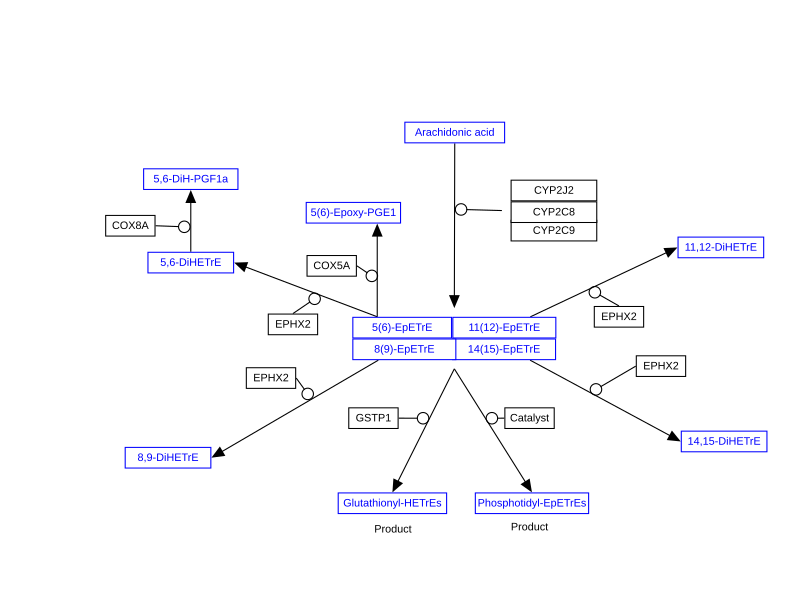
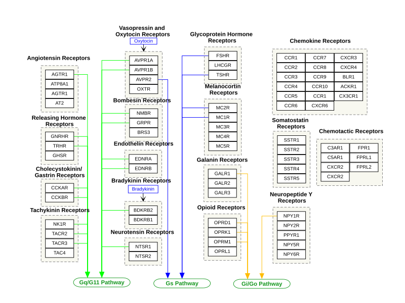
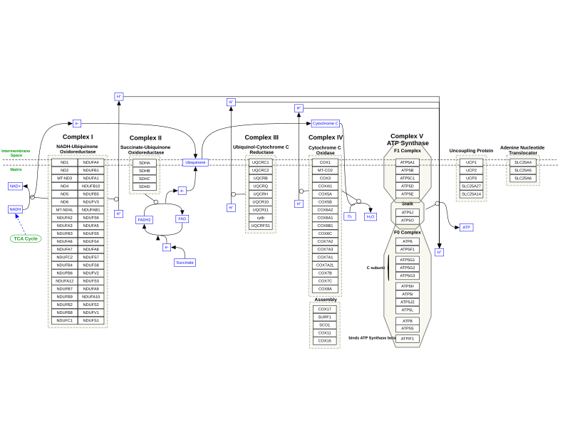

# WikiPathways 完整通路图：新增2219张

[返回本批用途分类](../MORE-OPEN-ART-2026-11-05.md)

本来源新增SVG 2219张、原生高清 0张、原生标准 0张。官方approved-GPML下游完整SVG通路图；逐图保留物种、作者、版本和固定JSON元数据地址。

固定版本：[b171290fc3937590b673a602a71781ae4afa57fc](https://github.com/wikipathways/wikipathways-assets/tree/b171290fc3937590b673a602a71781ae4afa57fc)。许可概览：CC0-1.0；使用时请保留逐图作者、原作品链接和具体许可。

标准尺寸位图适合PPT中的小幅示意图，放大前请核对实际宽高；SVG可按需要放大。完整署名保存在[全库清单](../../data/manifest.csv)。

通路图有44个物种，名称保留物种与WP编号；不同物种不能混作同一人类通路。所有图为独立可缩放SVG，图的revision以本固定版本元数据为准，发表前请核对研究适用性。

## 预览

## 下载分册

| 分册 | 图片数 | 范围 |
| --- | ---: | --- |
| [第1册](wikipathways-01.md) | 100 | 1–100 |
| [第2册](wikipathways-02.md) | 100 | 101–200 |
| [第3册](wikipathways-03.md) | 100 | 201–300 |
| [第4册](wikipathways-04.md) | 100 | 301–400 |
| [第5册](wikipathways-05.md) | 100 | 401–500 |
| [第6册](wikipathways-06.md) | 100 | 501–600 |
| [第7册](wikipathways-07.md) | 100 | 601–700 |
| [第8册](wikipathways-08.md) | 100 | 701–800 |
| [第9册](wikipathways-09.md) | 100 | 801–900 |
| [第10册](wikipathways-10.md) | 100 | 901–1000 |
| [第11册](wikipathways-11.md) | 100 | 1001–1100 |
| [第12册](wikipathways-12.md) | 100 | 1101–1200 |
| [第13册](wikipathways-13.md) | 100 | 1201–1300 |
| [第14册](wikipathways-14.md) | 100 | 1301–1400 |
| [第15册](wikipathways-15.md) | 100 | 1401–1500 |
| [第16册](wikipathways-16.md) | 100 | 1501–1600 |
| [第17册](wikipathways-17.md) | 100 | 1601–1700 |
| [第18册](wikipathways-18.md) | 100 | 1701–1800 |
| [第19册](wikipathways-19.md) | 100 | 1801–1900 |
| [第20册](wikipathways-20.md) | 100 | 1901–2000 |
| [第21册](wikipathways-21.md) | 100 | 2001–2100 |
| [第22册](wikipathways-22.md) | 100 | 2101–2200 |
| [第23册](wikipathways-23.md) | 19 | 2201–2219 |
