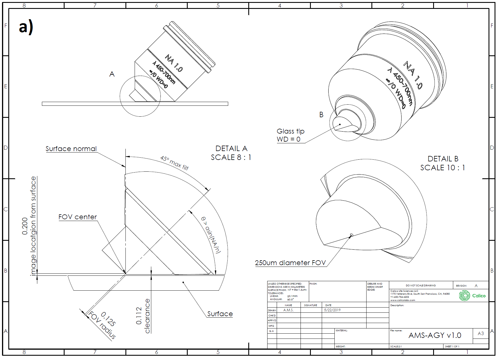
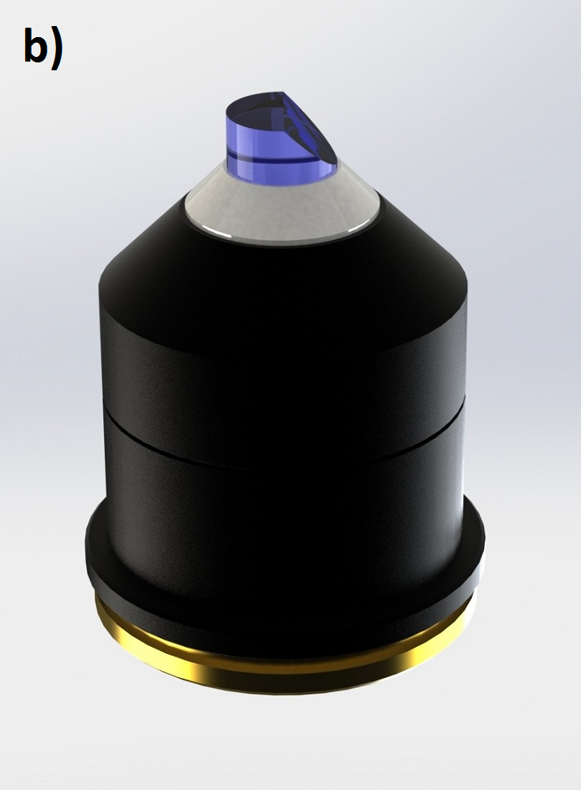
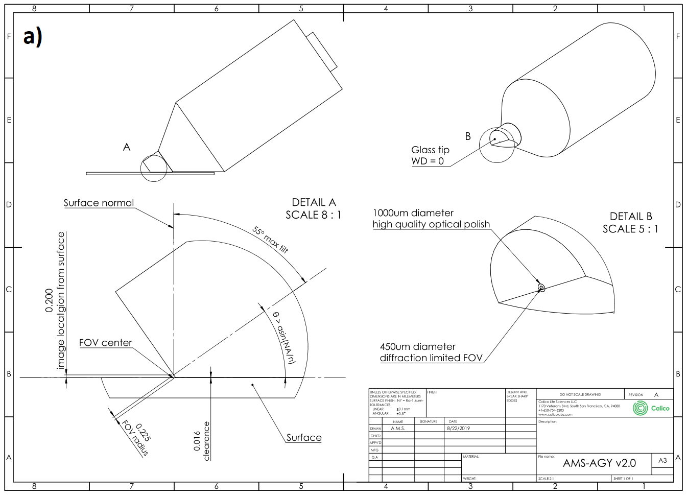
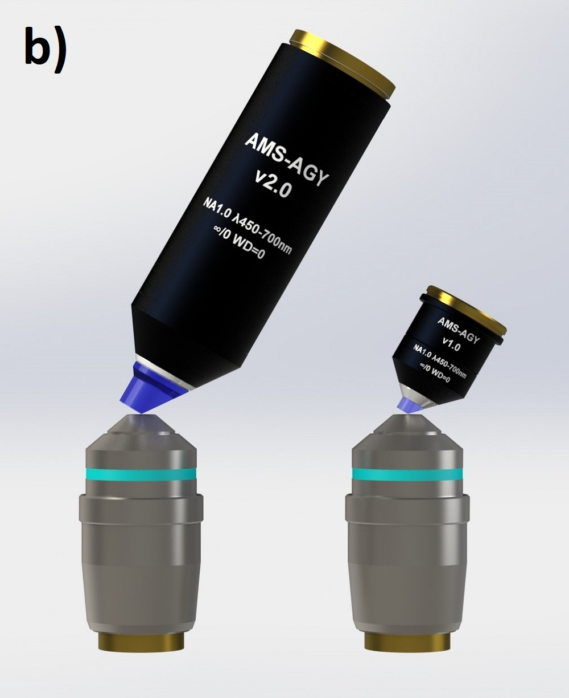
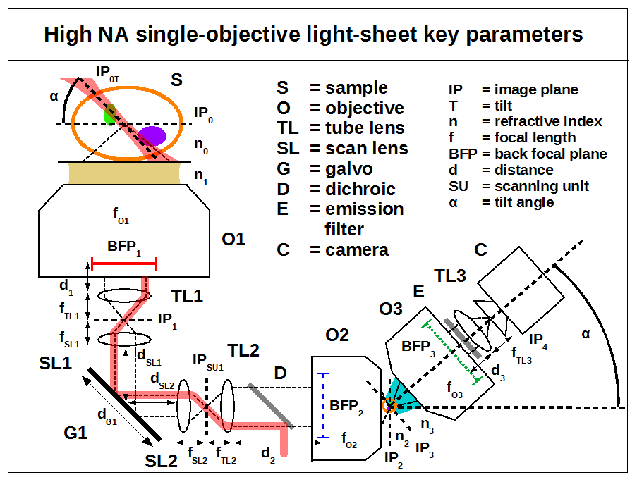
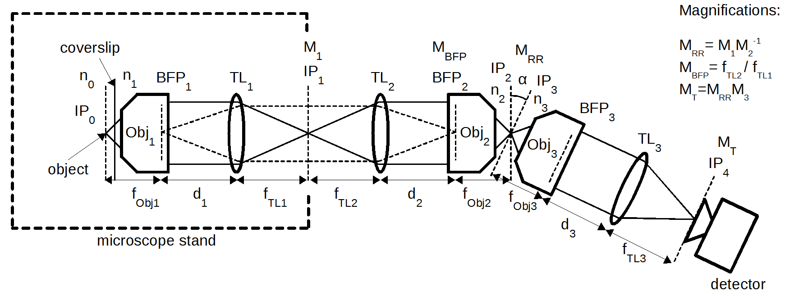

# 高NA单物镜光片显微镜原创图：新增22张

[返回本批用途分类](../MORE-OPEN-ART-2026-11-05.md)

本来源新增SVG 0张、原生高清 16张、原生标准 6张。论文作者的光路、Ewald球、不同有效焦距管镜与机械装置示意原图。

固定版本：[46a205567133d98b188af112b857751b91f6c13c](https://github.com/AndrewGYork/high_na_single_objective_lightsheet/tree/46a205567133d98b188af112b857751b91f6c13c)。许可概览：CC-BY-4.0；使用时请保留逐图作者、原作品链接和具体许可。

标准尺寸位图适合PPT中的小幅示意图，放大前请核对实际宽高；SVG可按需要放大。完整署名保存在[全库清单](../../data/manifest.csv)。

## 预览

## 下载分册

| 分册 | 图片数 | 范围 |
| --- | ---: | --- |
| [第1册](york-high-na-lightsheet-01.md) | 22 | 1–22 |
