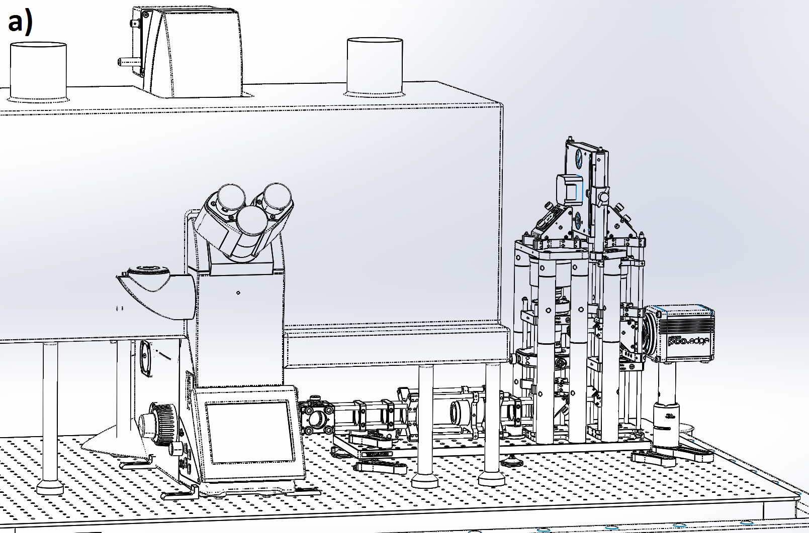
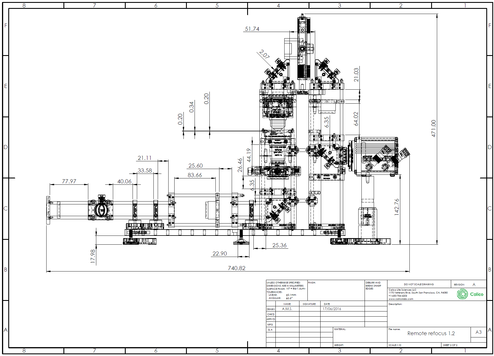
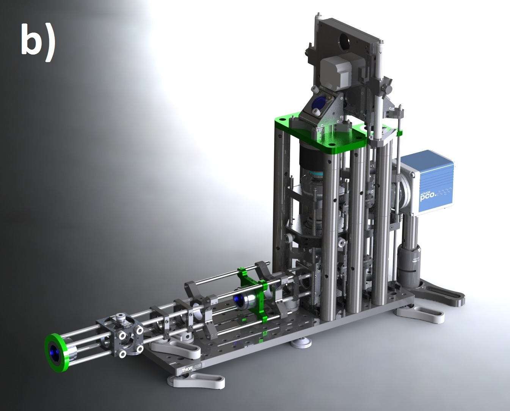
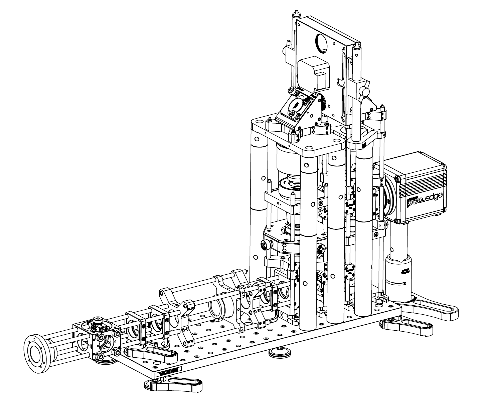
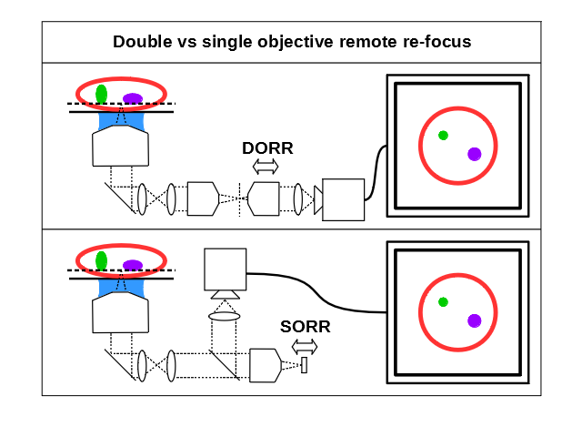

# 远程重聚焦原创光学插图：新增5张

[返回本批用途分类](../MORE-OPEN-ART-2026-11-05.md)

本来源新增SVG 0张、原生高清 2张、原生标准 3张。论文作者开放发布的双倍/单倍远程重聚焦光路与装置原图，保留作者及论文图注。

固定版本：[284efac5354fdfdd4a6dc2dc21c68e06eea53c7c](https://github.com/AndrewGYork/remote_refocus/tree/284efac5354fdfdd4a6dc2dc21c68e06eea53c7c)。许可概览：CC-BY-4.0；使用时请保留逐图作者、原作品链接和具体许可。

标准尺寸位图适合PPT中的小幅示意图，放大前请核对实际宽高；SVG可按需要放大。完整署名保存在[全库清单](../../data/manifest.csv)。

## 预览

## 下载分册

| 分册 | 图片数 | 范围 |
| --- | ---: | --- |
| [第1册](york-remote-refocus-01.md) | 5 | 1–5 |
