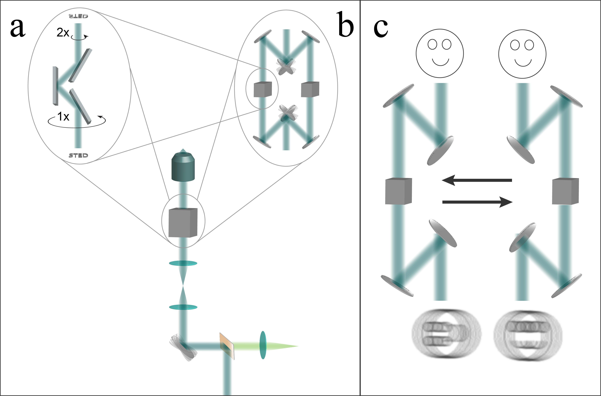
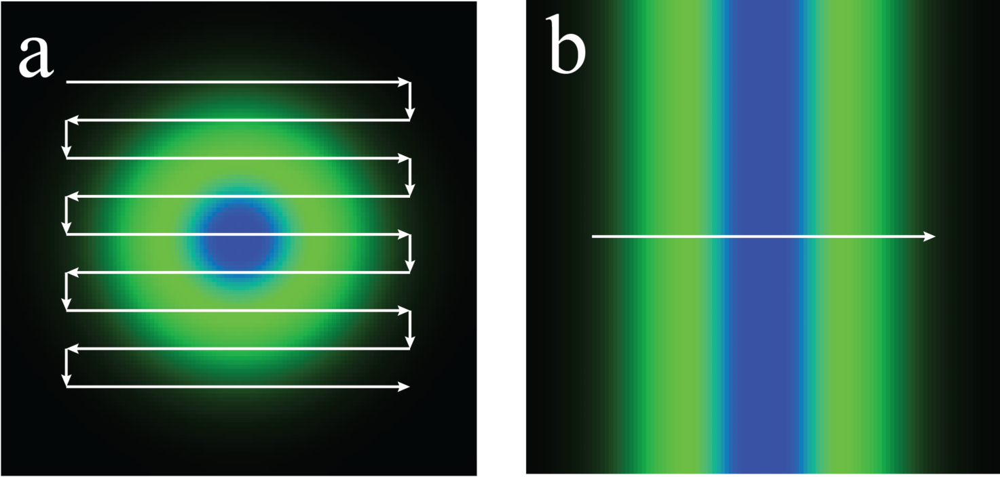

# Rescan Line STED 显微光学图：新增2张

[返回本批用途分类](../MORE-OPEN-ART-2026-11-05.md)

本来源新增SVG 0张、原生高清 1张、原生标准 1张。原创点/线扫描与光路切换示意图；不收实验照片、动画帧和结果曲线。

固定版本：[4a40942ec6237efaab873e8f7bcf4b81d7280b50](https://github.com/AndrewGYork/rescan_line_sted/tree/4a40942ec6237efaab873e8f7bcf4b81d7280b50)。许可概览：CC-BY-4.0；使用时请保留逐图作者、原作品链接和具体许可。

标准尺寸位图适合PPT中的小幅示意图，放大前请核对实际宽高；SVG可按需要放大。完整署名保存在[全库清单](../../data/manifest.csv)。

## 预览

## 下载分册

| 分册 | 图片数 | 范围 |
| --- | ---: | --- |
| [第1册](york-rescan-sted-01.md) | 2 | 1–2 |
