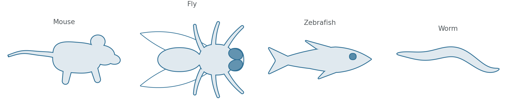
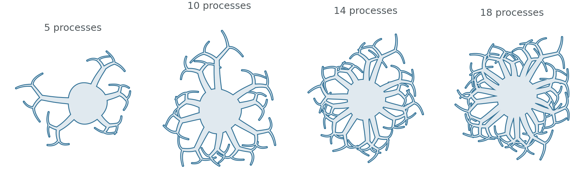
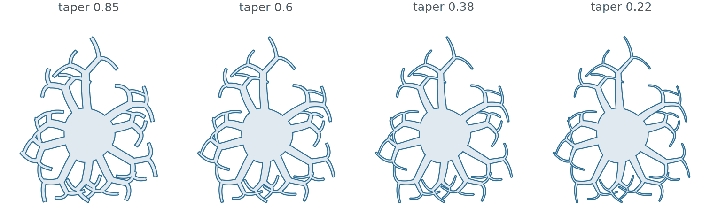
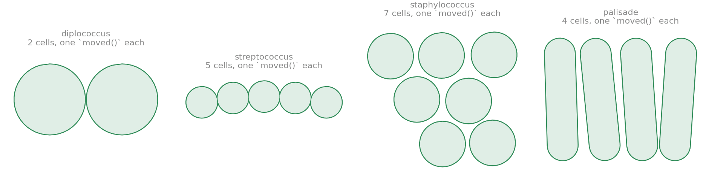
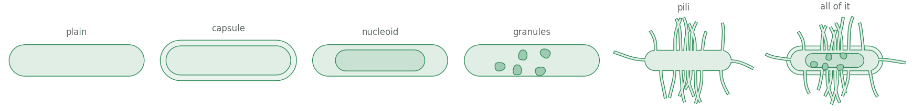
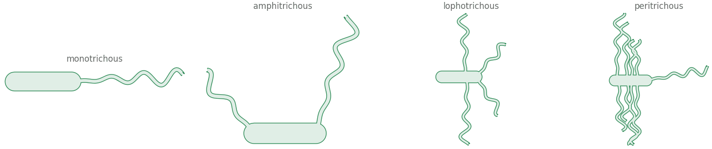

# Biodraw 生物学参数化示意图：新增49张

[返回本批用途分类](../MORE-OPEN-ART-2026-11-06.md)

本来源SVG 0张、原生高清 19张、原生标准 30张。上游已发布的细胞、神经元、微生物、动物及实验仪器PNG；是参数化示意图，未重新生成或放大。

固定版本：[66a3e332946964e4a06fe4efca56fb99125c765c](https://github.com/deangeckt/biodraw/tree/66a3e332946964e4a06fe4efca56fb99125c765c)。许可概览：MIT；具体以逐图记录与原声明为准。

## 预览

## 下载分册

| 分册 | 图片数 | 范围 |
| --- | ---: | --- |
| [第1册](biodraw-01.md) | 49 | 1–49 |
