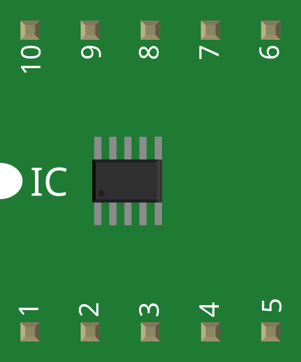
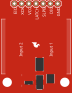
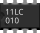

# Fritzing 实验电子器件插图：新增708张

[返回本批用途分类](../MORE-OPEN-ART-2026-11-06.md)

本来源SVG 708张、原生高清 0张、原生标准 0张。传感器、实验板、控制器、电机、显示、供电与电子元件原始breadboard-view SVG；保留器件作者及FZP证据。

固定版本：[27535f2fd02097be9bed229b75aa8e9be282a4a0](https://github.com/fritzing/fritzing-parts/tree/27535f2fd02097be9bed229b75aa8e9be282a4a0)。许可概览：CC-BY-SA-3.0；具体以逐图记录与原声明为准。

## 预览

## 下载分册

| 分册 | 图片数 | 范围 |
| --- | ---: | --- |
| [第1册](fritzing-components-01.md) | 100 | 1–100 |
| [第2册](fritzing-components-02.md) | 100 | 101–200 |
| [第3册](fritzing-components-03.md) | 100 | 201–300 |
| [第4册](fritzing-components-04.md) | 100 | 301–400 |
| [第5册](fritzing-components-05.md) | 100 | 401–500 |
| [第6册](fritzing-components-06.md) | 100 | 501–600 |
| [第7册](fritzing-components-07.md) | 100 | 601–700 |
| [第8册](fritzing-components-08.md) | 8 | 701–708 |
