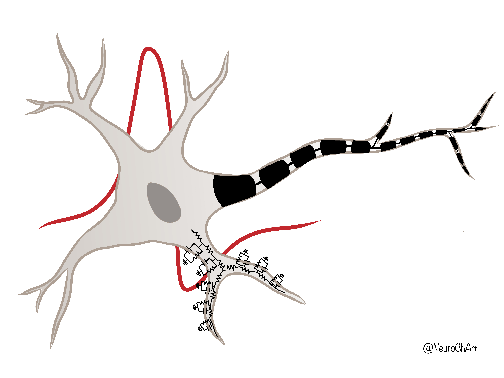
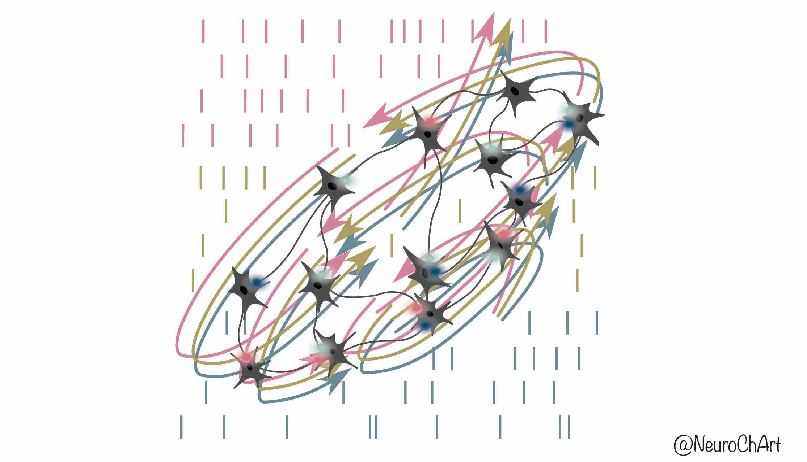
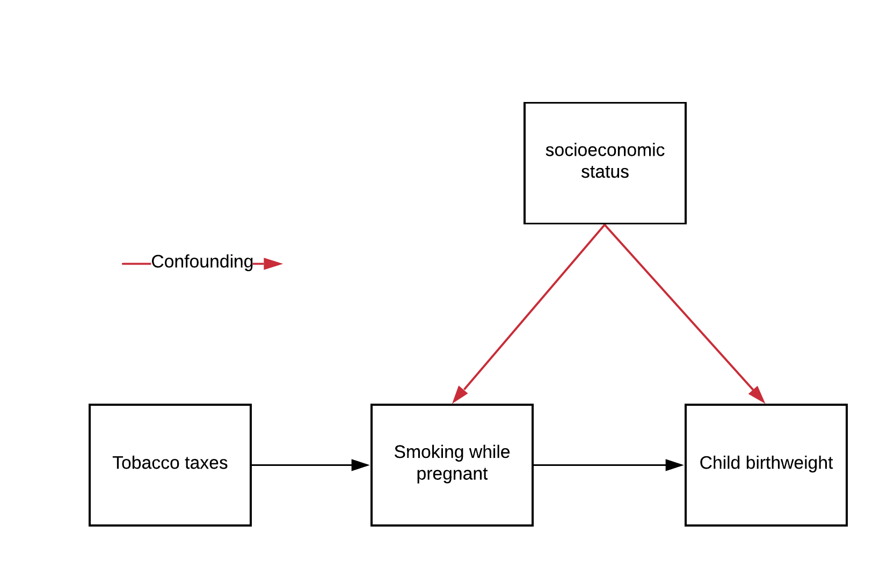
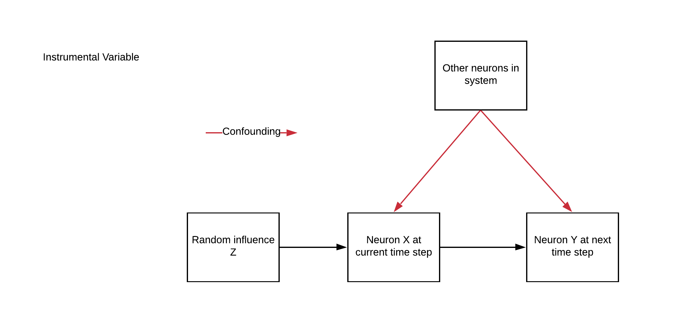
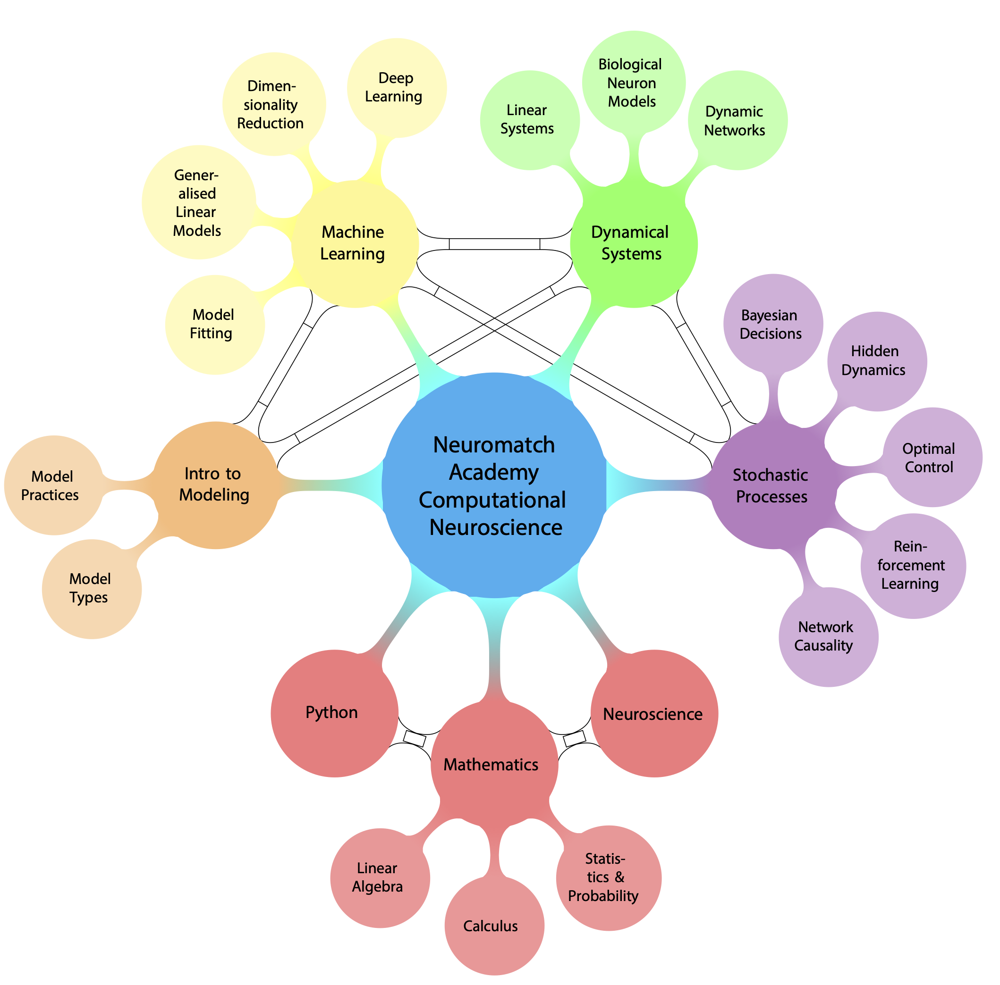

# Neuromatch 神经科学原创插画：新增6张

[返回本批用途分类](../MORE-OPEN-ART-2026-11-06.md)

本来源SVG 0张、原生高清 6张、原生标准 0张。课程作者手绘的神经科学方法、因果及概念图；保留画师署名和原生高清尺寸。

固定版本：[44634e960df7a14cd0bf7398187f2d209d26b0e8](https://github.com/NeuromatchAcademy/course-content/tree/44634e960df7a14cd0bf7398187f2d209d26b0e8)。许可概览：CC-BY-4.0；具体以逐图记录与原声明为准。

## 预览

## 下载分册

| 分册 | 图片数 | 范围 |
| --- | ---: | --- |
| [第1册](neuromatch-illustrations-01.md) | 6 | 1–6 |
