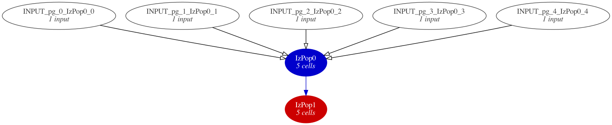
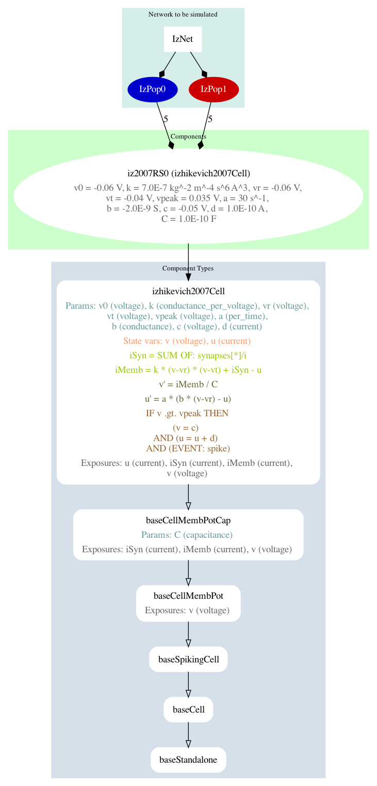
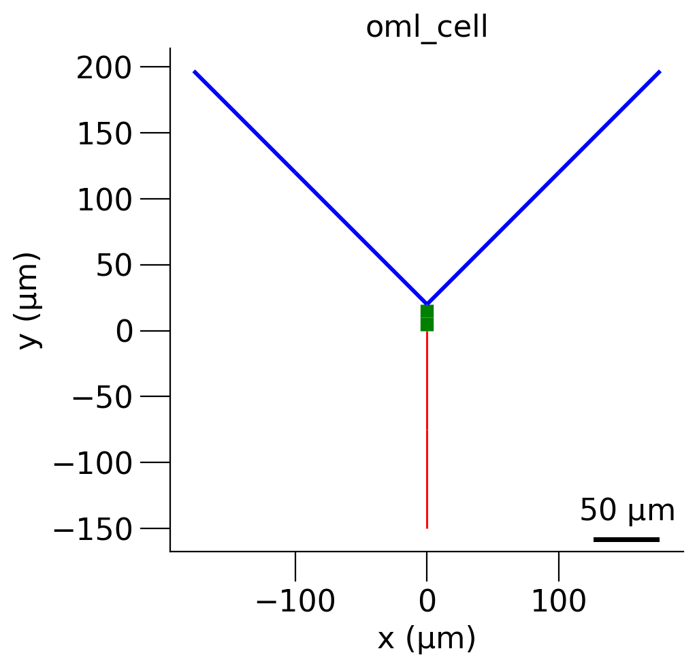
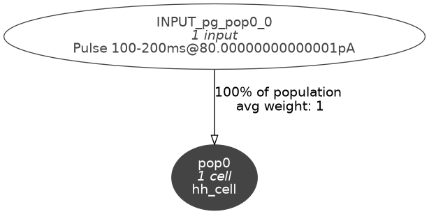
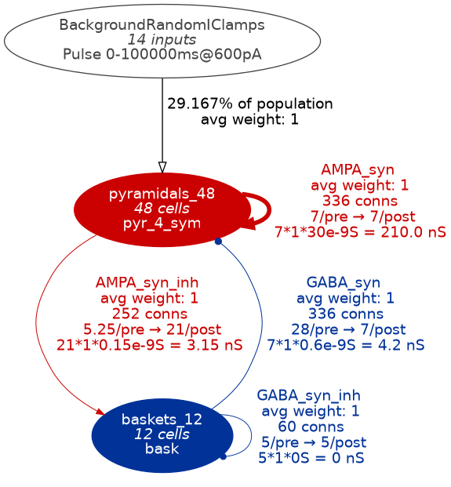
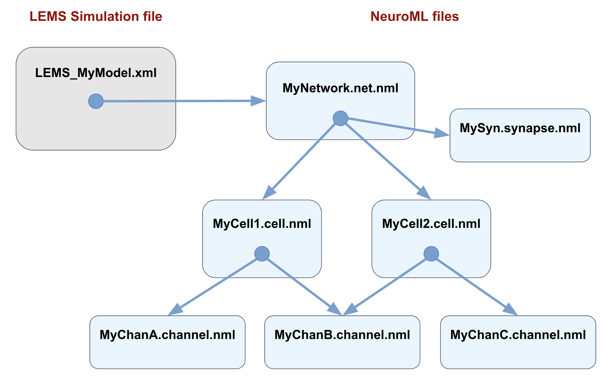

# NeuroML 神经模型结构图：新增7张

[返回本批用途分类](../MORE-OPEN-ART-2026-11-06.md)

本来源SVG 1张、原生高清 1张、原生标准 5张。神经网络模型、结构摘要与仿真流程原图；不收实验结果曲线或软件截图。

固定版本：[aec7c08234393d7523b3b48ce3218ffed00f01ff](https://github.com/NeuroML/Documentation/tree/aec7c08234393d7523b3b48ce3218ffed00f01ff)。许可概览：CC-BY-4.0；具体以逐图记录与原声明为准。

## 预览

## 下载分册

| 分册 | 图片数 | 范围 |
| --- | ---: | --- |
| [第1册](neuroml-diagrams-01.md) | 7 | 1–7 |
