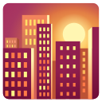

# Noto 科研彩色插图选集：新增443张

[返回本批用途分类](../MORE-OPEN-ART-2026-11-06.md)

本来源SVG 443张、原生高清 0张、原生标准 0张。动物、植物、人体、实验设备、工程和天气天文彩色SVG；仅图像目录Apache2许可，不套用字体OFL。

固定版本：[99701e07d3d1fe1bdbcdb14964547f0fd592966f](https://github.com/googlefonts/noto-emoji/tree/99701e07d3d1fe1bdbcdb14964547f0fd592966f)。许可概览：Apache-2.0；具体以逐图记录与原声明为准。

这是风格化科研交流图形，每主题仅收一种默认彩色版本，不重复Flat/3D/肤色版本，不称为按比例的器官或机制图。

图像Apache2证据是`2D/svg/LICENSE`；根目录的OFL用于字体，不用于本批SVG。完整Apache2文本与原版权声明在[本地许可目录](../../licenses/noto-science/)。

## 预览

## 下载分册

| 分册 | 图片数 | 范围 |
| --- | ---: | --- |
| [第1册](noto-science-01.md) | 100 | 1–100 |
| [第2册](noto-science-02.md) | 100 | 101–200 |
| [第3册](noto-science-03.md) | 100 | 201–300 |
| [第4册](noto-science-04.md) | 100 | 301–400 |
| [第5册](noto-science-05.md) | 43 | 401–443 |
