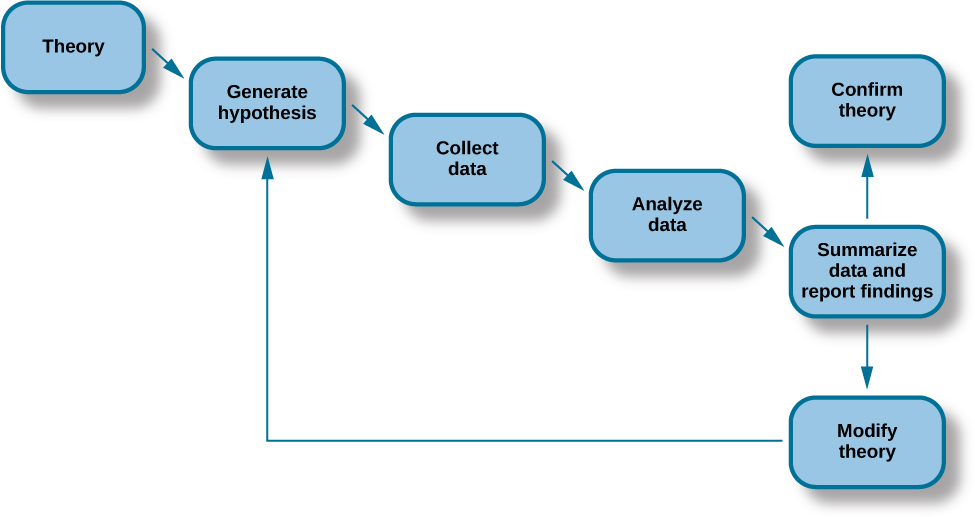
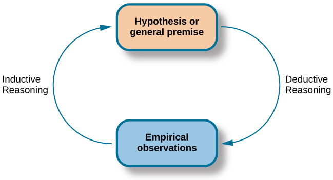
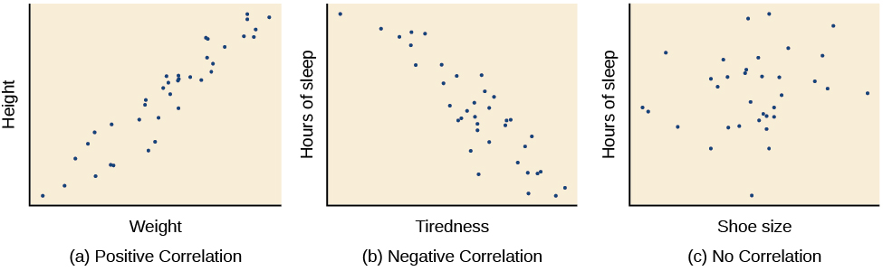
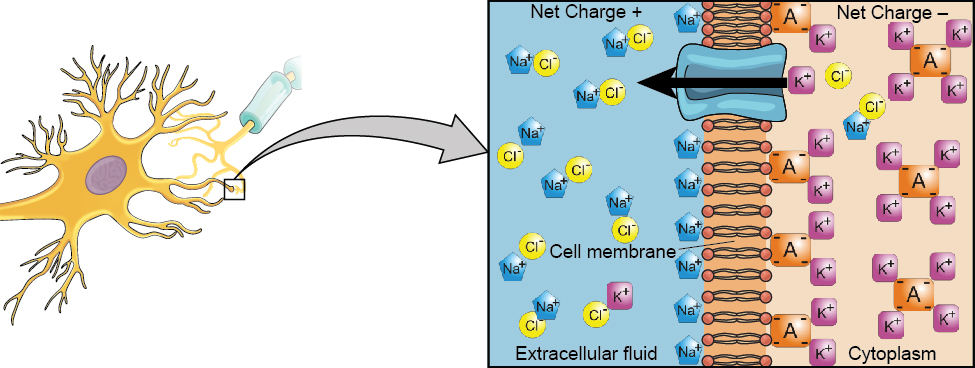
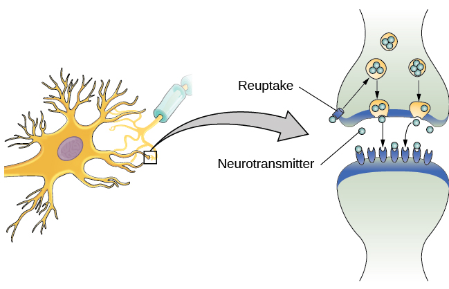
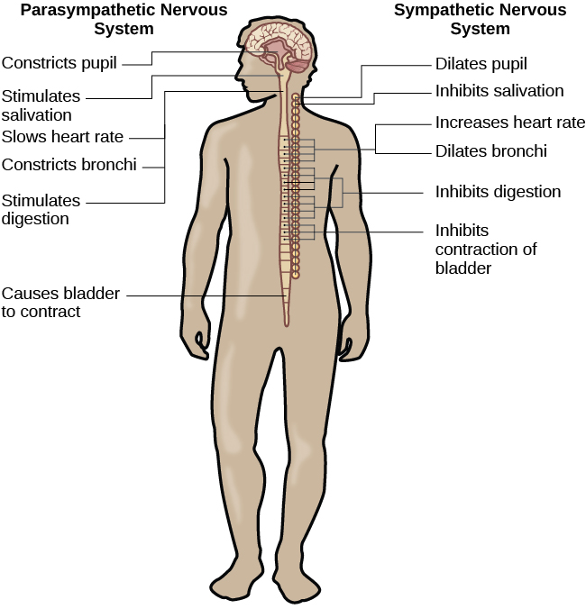

# OpenStax 心理与神经科学历史开放图：新增59张

[返回本批用途分类](../MORE-OPEN-ART-2026-11-06.md)

本来源SVG 0张、原生高清 0张、原生标准 59张。固定历史CC BY4版本中的脑、神经、感知、学习和科研方法示意图，逐图排除第三方图像。

固定版本：[e061043bf2f9e86ace51c4e8dc9555160f60a99d](https://github.com/openstax/osbooks-psychology/tree/e061043bf2f9e86ace51c4e8dc9555160f60a99d)。许可概览：CC-BY-4.0；具体以逐图记录与原声明为准。

## 预览

## 下载分册

| 分册 | 图片数 | 范围 |
| --- | ---: | --- |
| [第1册](openstax-psychology-01.md) | 59 | 1–59 |
