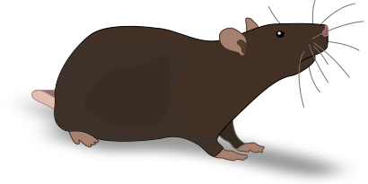
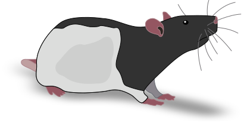
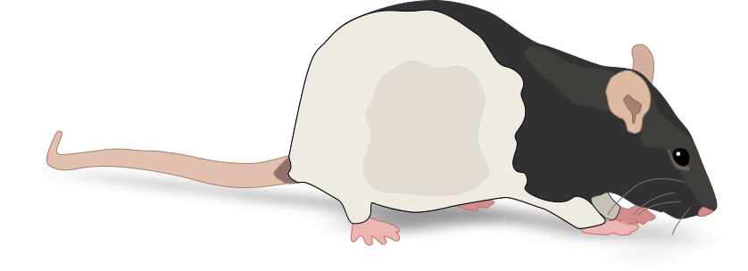
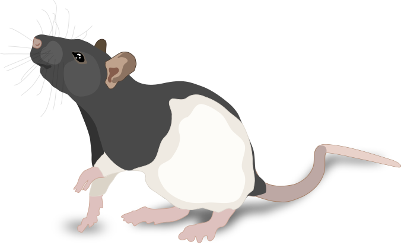
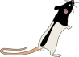
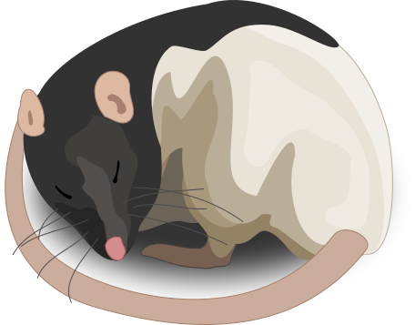

# Ratpack 实验鼠与行为图形：新增12张

[返回本批用途分类](../MORE-OPEN-ART-2026-11-06.md)

本来源SVG 12张、原生高清 0张、原生标准 0张。为出版物和研究插画绘制的实验鼠及行为场景SVG，保留原作及嵌入组件，不重复总览图板或PNG版本。

固定版本：[6173a51af3b72a2e5e12a91eff547c07c951f55f](https://github.com/eackermann/ratpack/tree/6173a51af3b72a2e5e12a91eff547c07c951f55f)。许可概览：MIT；具体以逐图记录与原声明为准。

## 预览

## 下载分册

| 分册 | 图片数 | 范围 |
| --- | ---: | --- |
| [第1册](ratpack-01.md) | 12 | 1–12 |
