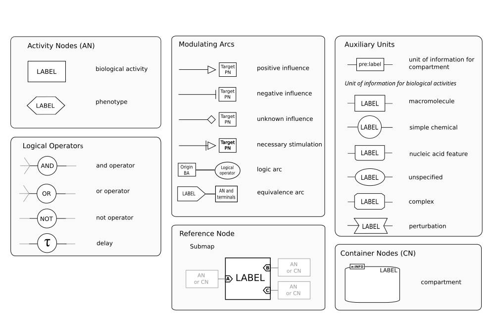
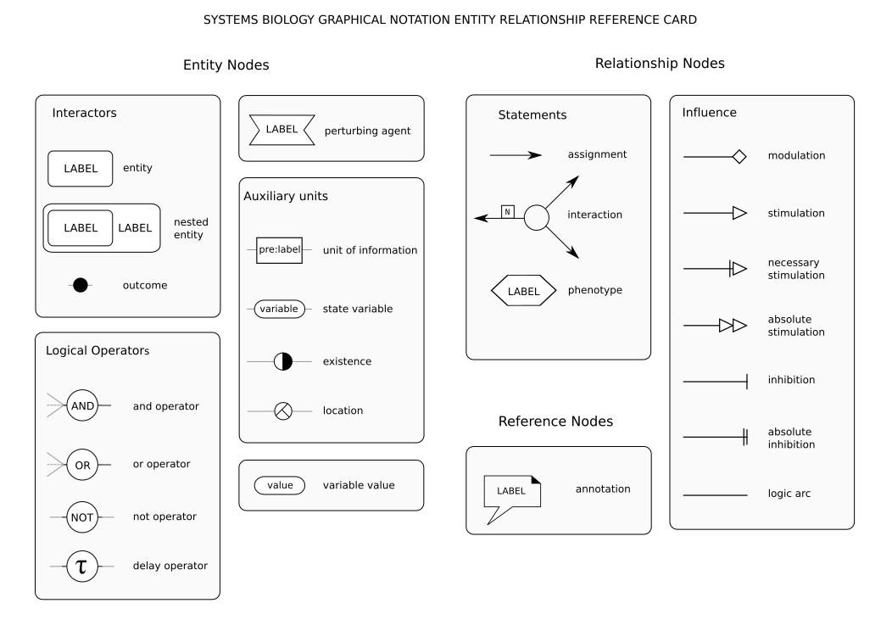
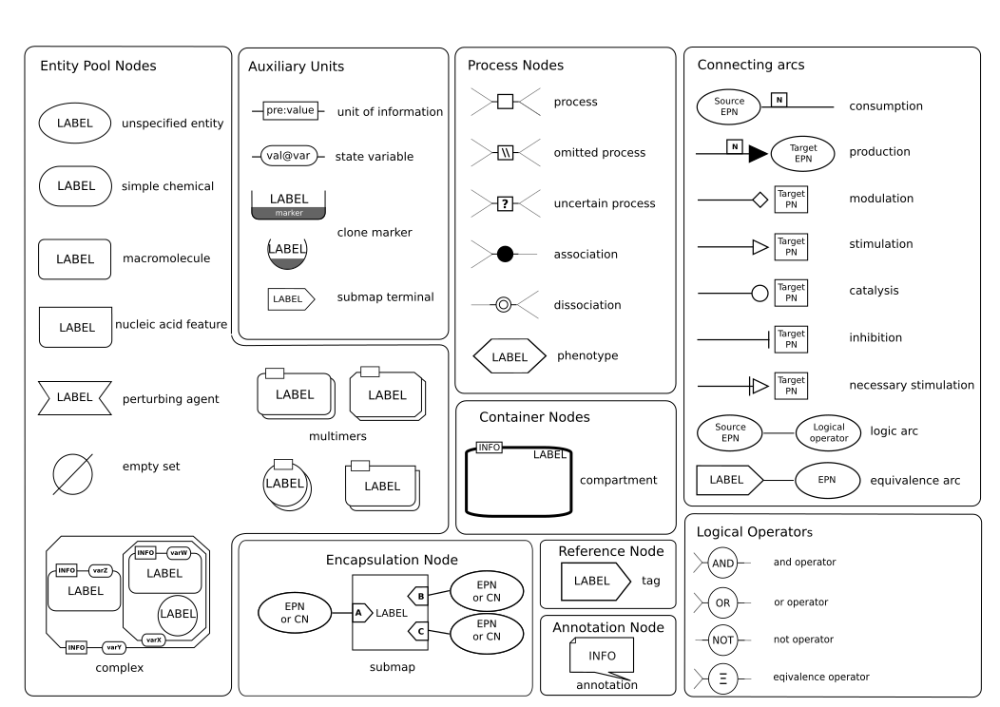
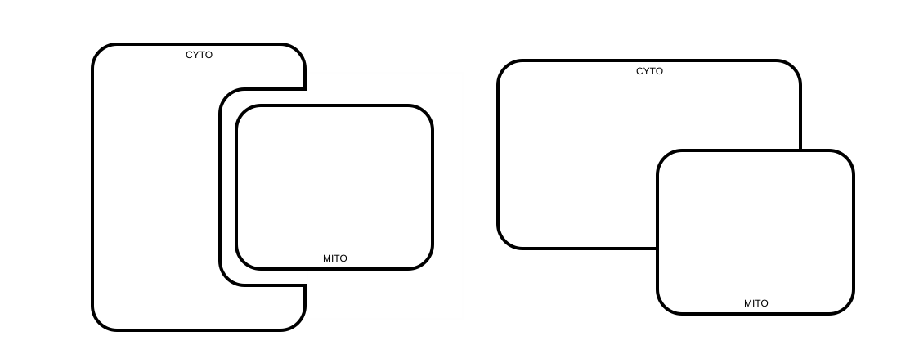

# SBGN 生物过程标准图形：新增48张

[返回本批用途分类](../MORE-OPEN-ART-2026-11-06.md)

本来源SVG 48张、原生高清 0张、原生标准 0张。生物过程符号、规范示例、参考图板和iNOS通路SVG；保留原始标注及规范版本。

固定版本：[d2cc88d34863ebd8cb1e6815ed9e0e07d2555b80](https://github.com/sbgn/sbgn.github.io/tree/d2cc88d34863ebd8cb1e6815ed9e0e07d2555b80)。许可概览：CC0-1.0；具体以逐图记录与原声明为准。

## 预览

## 下载分册

| 分册 | 图片数 | 范围 |
| --- | ---: | --- |
| [第1册](sbgn-scientific-diagrams-01.md) | 48 | 1–48 |
