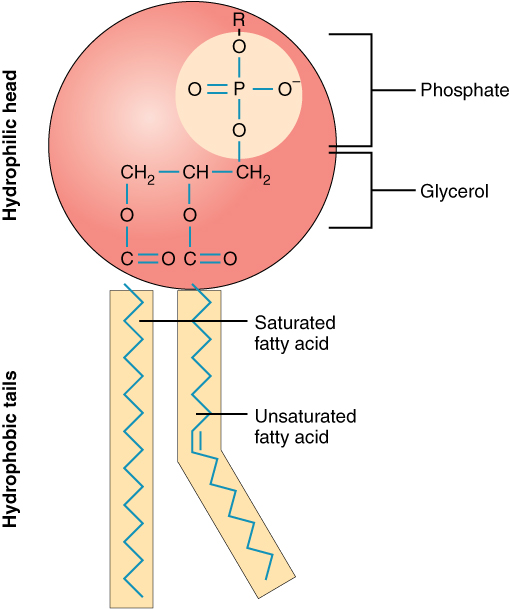
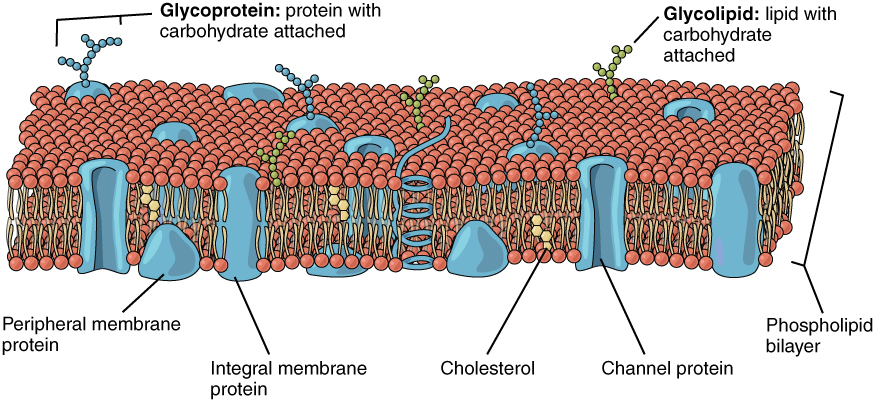
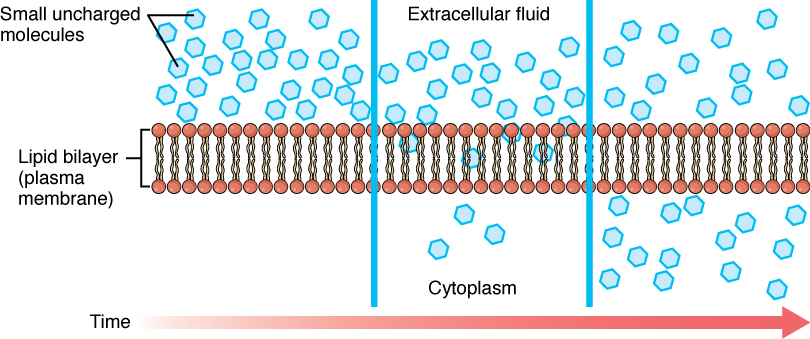
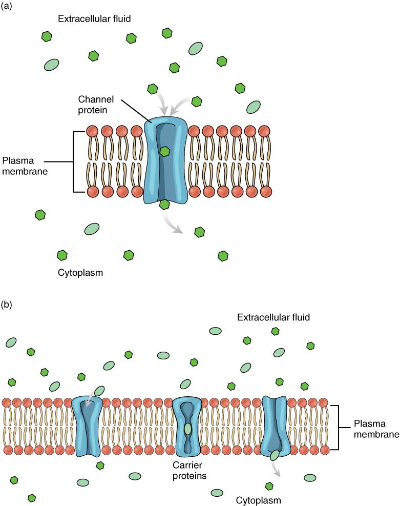
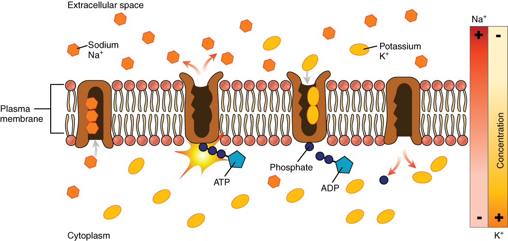
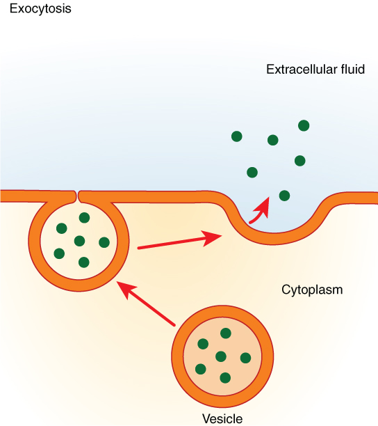

# OpenStax 人体解剖与生理历史开放插画：本批新增338张

[返回本批分类目录](../BULK-OPEN-ART-2026-11-04.md)

本页仅包含本批新增图片：SVG 0张、原生高清 78张、原生标准 260张。已有图不在本批重复计数。

固定来源：[https://github.com/openstax/osbooks-anatomy-physiology](https://github.com/openstax/osbooks-anatomy-physiology/tree/b0058a743bdd2cc08196abaaa7d5469970c0d80c)。许可概览：CC-BY-4.0，以每张记录为准。

PNG/JPEG可以直接插入PowerPoint；标准图适合小幅排版，放大前请核对实际像素。SVG保留原始画布与全部标注。复用时请保留相应作者、作品来源及许可，改编时标明修改。

## 预览

## 下载分册

| 分册 | 图片数 | 范围 |
| --- | ---: | --- |
| [第1册](openstax-anatomy-01.md) | 100 | 1–100 |
| [第2册](openstax-anatomy-02.md) | 100 | 101–200 |
| [第3册](openstax-anatomy-03.md) | 100 | 201–300 |
| [第4册](openstax-anatomy-04.md) | 38 | 301–338 |
