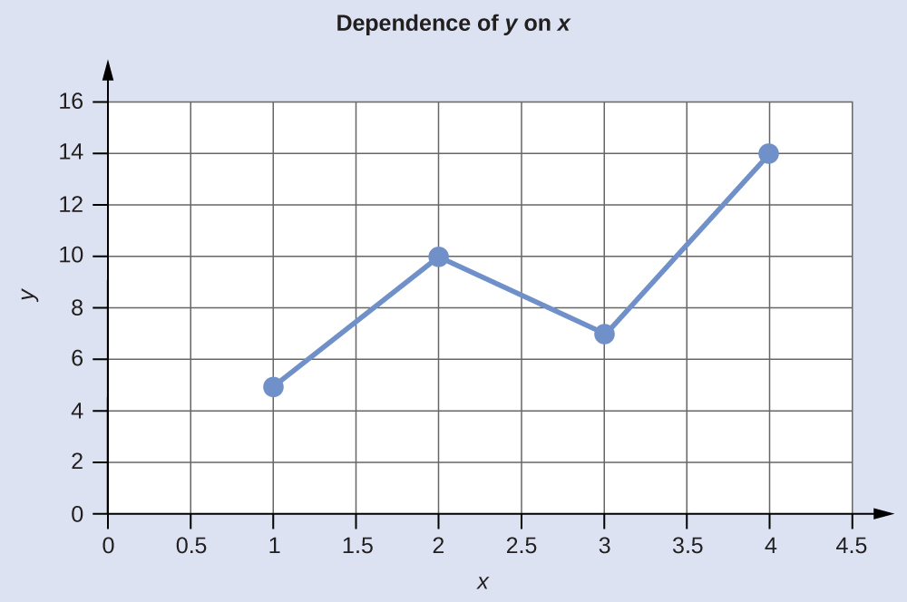
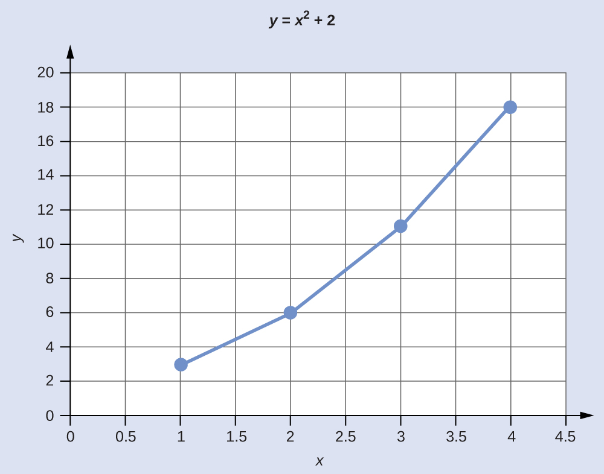
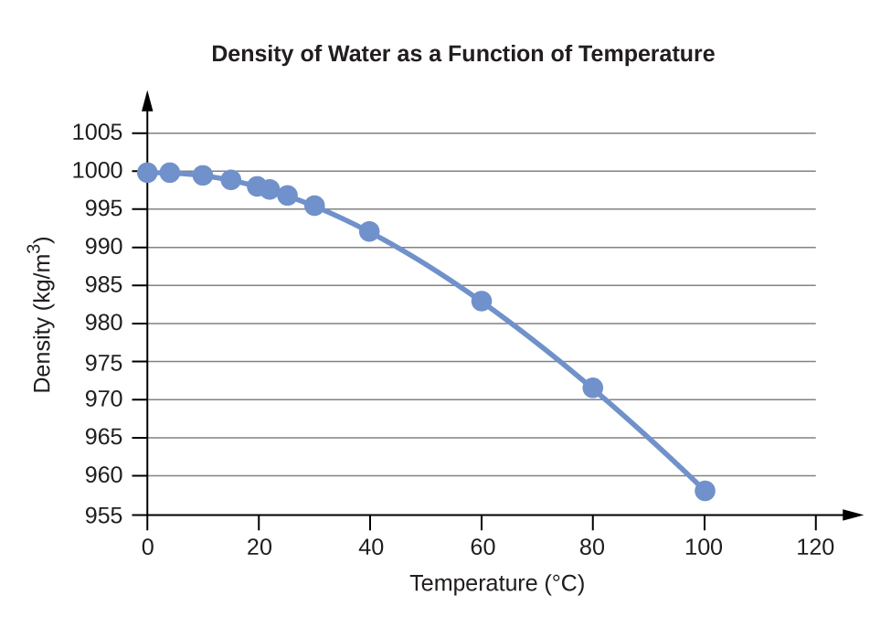
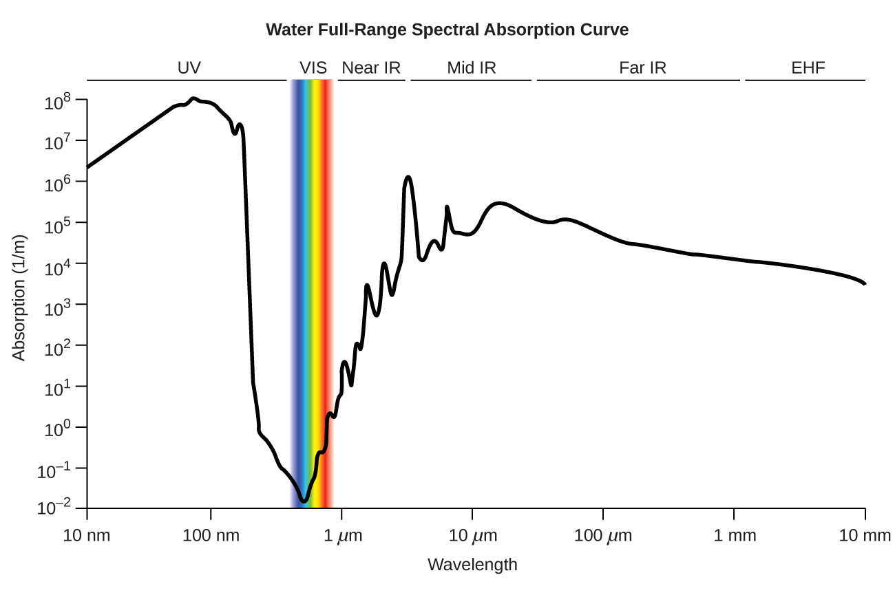
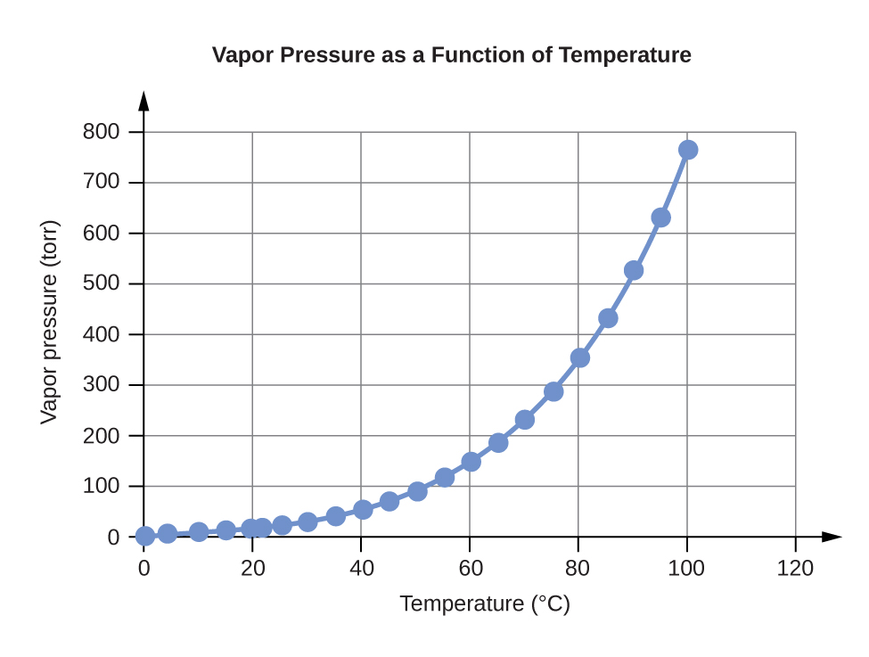
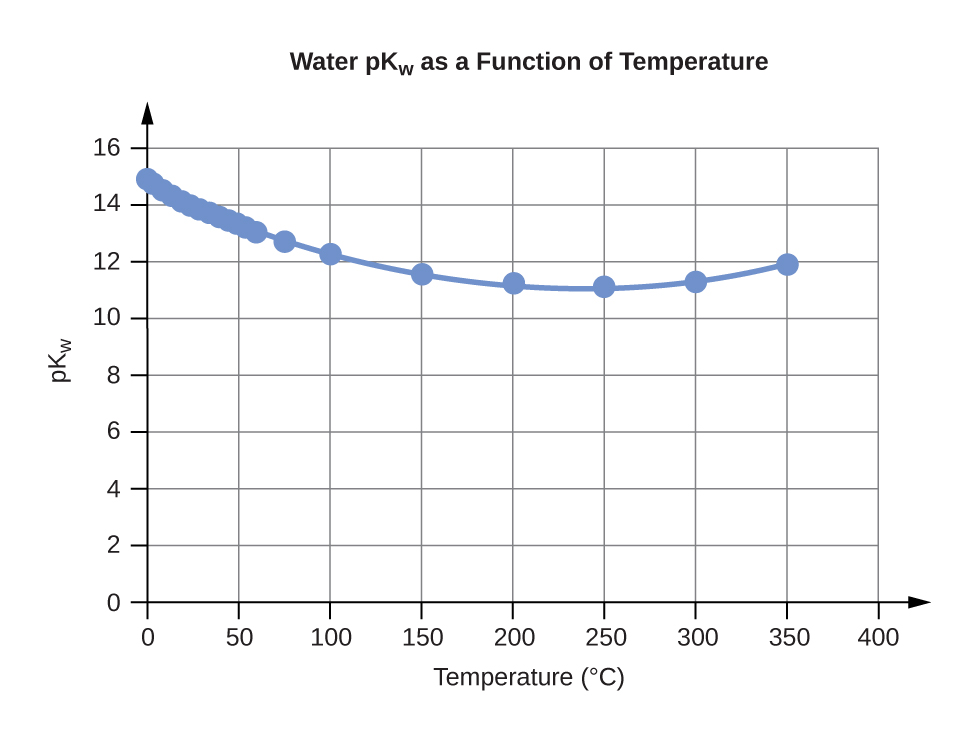

# OpenStax 化学历史开放插画：本批新增442张

[返回本批分类目录](../BULK-OPEN-ART-2026-11-04.md)

本页仅包含本批新增图片：SVG 0张、原生高清 0张、原生标准 442张。已有图不在本批重复计数。

固定来源：[https://github.com/openstax/osbooks-chemistry-bundle](https://github.com/openstax/osbooks-chemistry-bundle/tree/32c719622fbb7a0ca729cd645c1df4cf4e7d5b3a)。许可概览：CC-BY-4.0，以每张记录为准。

PNG/JPEG可以直接插入PowerPoint；标准图适合小幅排版，放大前请核对实际像素。SVG保留原始画布与全部标注。复用时请保留相应作者、作品来源及许可，改编时标明修改。

## 预览

## 下载分册

| 分册 | 图片数 | 范围 |
| --- | ---: | --- |
| [第1册](openstax-chemistry-01.md) | 100 | 1–100 |
| [第2册](openstax-chemistry-02.md) | 100 | 101–200 |
| [第3册](openstax-chemistry-03.md) | 100 | 201–300 |
| [第4册](openstax-chemistry-04.md) | 100 | 301–400 |
| [第5册](openstax-chemistry-05.md) | 42 | 401–442 |
