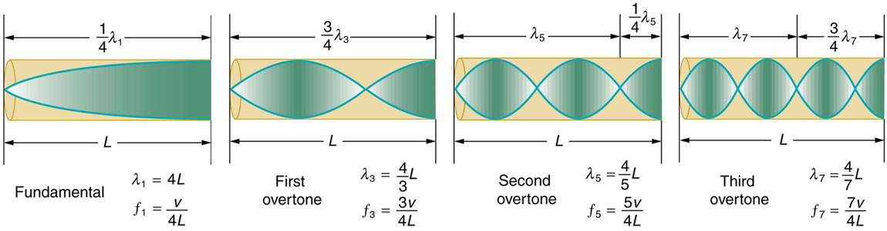

# OpenStax 基础物理开放插画：本批新增758张

[返回本批分类目录](../BULK-OPEN-ART-2026-11-04.md)

本页仅包含本批新增图片：SVG 0张、原生高清 0张、原生标准 758张。已有图不在本批重复计数。

固定来源：[https://github.com/openstax/osbooks-college-physics-bundle](https://github.com/openstax/osbooks-college-physics-bundle/tree/f98d7a792138a6133fe7267d17e70aa04e9ccbed)。许可概览：CC-BY-4.0，以每张记录为准。

PNG/JPEG可以直接插入PowerPoint；标准图适合小幅排版，放大前请核对实际像素。SVG保留原始画布与全部标注。复用时请保留相应作者、作品来源及许可，改编时标明修改。

## 预览

## 下载分册

| 分册 | 图片数 | 范围 |
| --- | ---: | --- |
| [第1册](openstax-college-physics-01.md) | 100 | 1–100 |
| [第2册](openstax-college-physics-02.md) | 100 | 101–200 |
| [第3册](openstax-college-physics-03.md) | 100 | 201–300 |
| [第4册](openstax-college-physics-04.md) | 100 | 301–400 |
| [第5册](openstax-college-physics-05.md) | 100 | 401–500 |
| [第6册](openstax-college-physics-06.md) | 100 | 501–600 |
| [第7册](openstax-college-physics-07.md) | 100 | 601–700 |
| [第8册](openstax-college-physics-08.md) | 58 | 701–758 |
