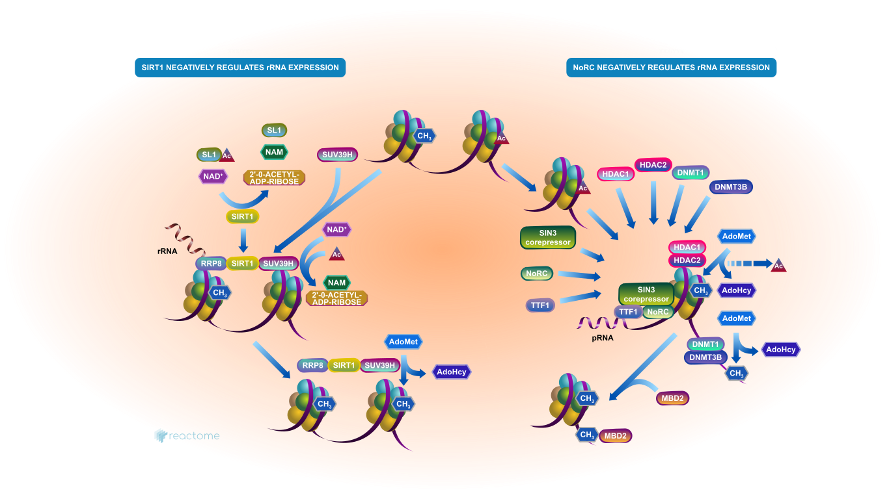
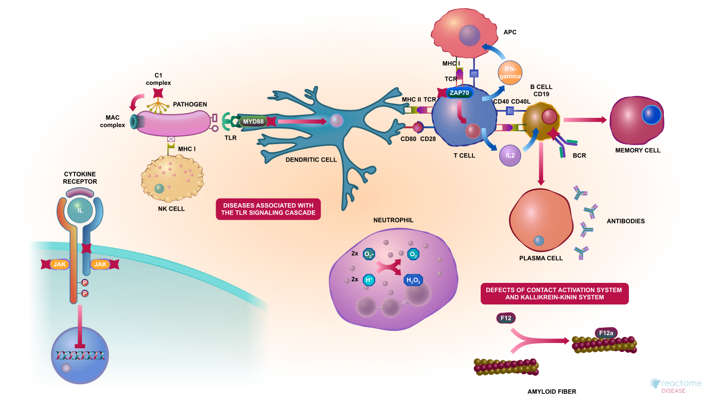
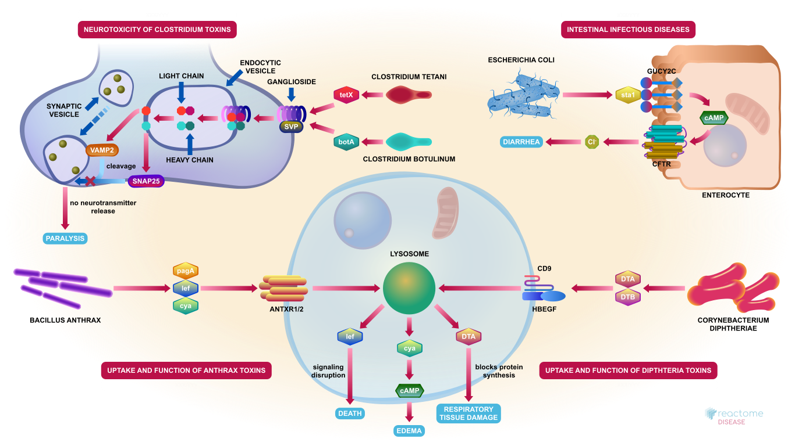
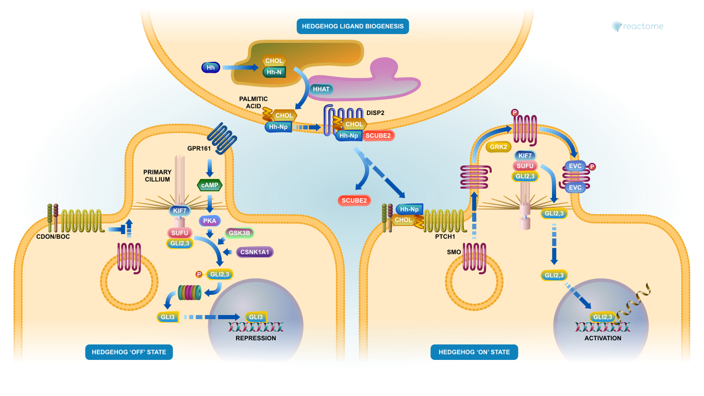
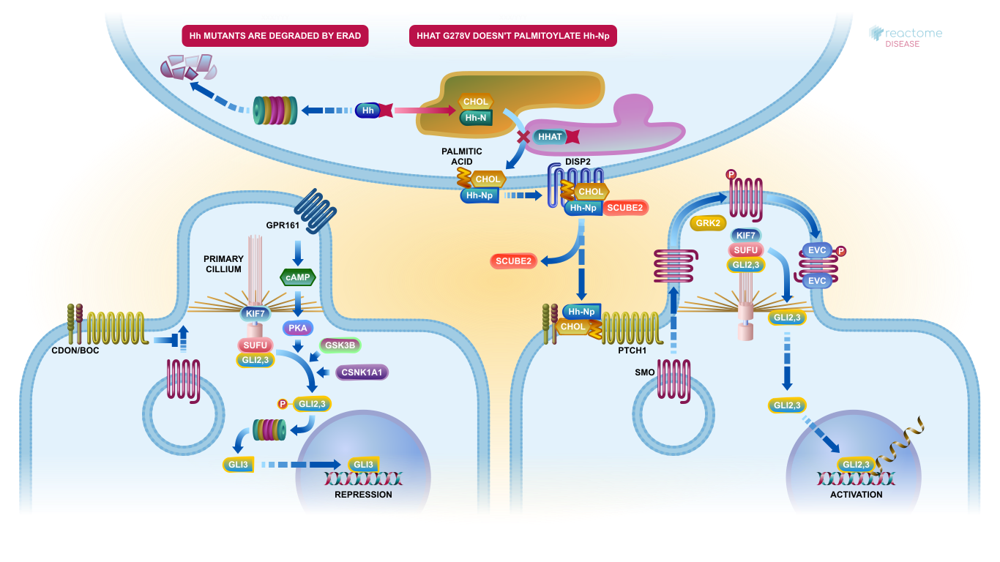
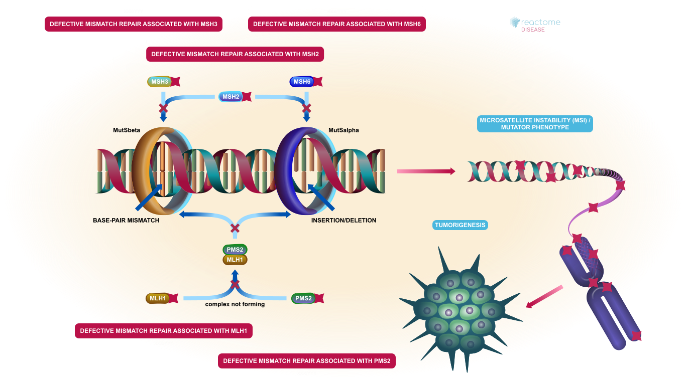

# Reactome Illustrations：本批新增91张

[返回本批分类目录](../BULK-OPEN-ART-2026-11-04.md)

本页仅包含本批新增图片：SVG 91张、原生高清 0张、原生标准 0张。已有图不在本批重复计数。

固定来源：[https://github.com/reactome/reactome_illustrations](https://github.com/reactome/reactome_illustrations/tree/9b70b1d706086d3d917f4150ab59aa65815b3c47)。许可概览：Apache-2.0，以每张记录为准。

PNG/JPEG可以直接插入PowerPoint；标准图适合小幅排版，放大前请核对实际像素。SVG保留原始画布与全部标注。复用时请保留相应作者、作品来源及许可，改编时标明修改。

## 预览

## 下载分册

| 分册 | 图片数 | 范围 |
| --- | ---: | --- |
| [第1册](reactome-01.md) | 91 | 1–91 |
